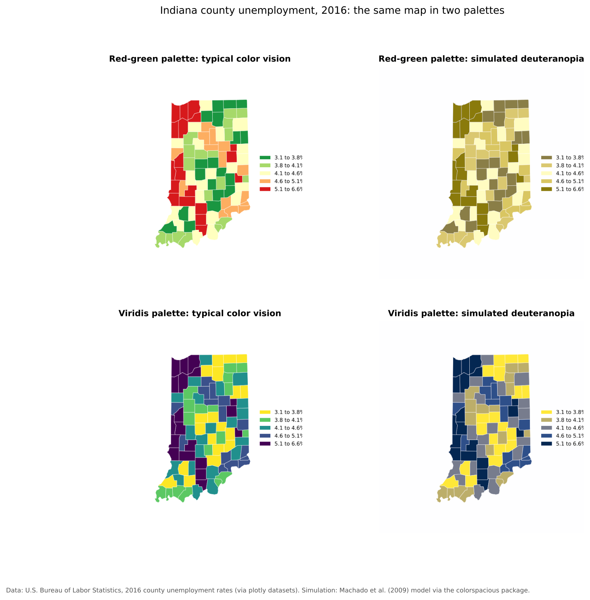

:::::::::::::::::::::::::::::::::::::: questions

- Why is accessibility important in cartography?
- How do different types of color vision deficiency affect map reading?
- How can we design maps that are readable for people with color vision deficiency?
- What roles do hue, saturation and lightness play in accessible design?
- How can I choose and test accessible palettes in QGIS and Python?

::::::::::::::::::::::::::::::::::::::::::::::::

::::::::::::::::::::::::::::::::::::: objectives

- Explain why accessibility matters in map design
- Describe the main types of color vision deficiency (CVD)
- Apply color-safe cartographic principles, especially varying lightness
- Select accessible color palettes in QGIS and Python
- Test maps with simulators and write useful alt text

::::::::::::::::::::::::::::::::::::::::::::::::

## Why accessibility matters in maps

Maps are communication tools. If part of your audience cannot read your colors, your map has failed for
them.

Accessible maps:

- Reach wider audiences
- Are easier to read for everyone, including on poor screens, projectors and greyscale printouts
- Reduce misunderstanding
- Are increasingly required for public and university websites and publications

::::::::::::::::::::::::::::::::::::: callout

### Key idea

Accessibility is not an extra step at the end. It is part of good cartographic design.

::::::::::::::::::::::::::::::::::::::::::::::::

---

## Understanding color vision deficiency

**Color vision deficiency (CVD)**, often called colorblindness, changes how some people distinguish
colors. Most people with CVD see color, but some pairs of colors look alike to them.

Among people of Northern European ancestry, about **8% of men** and **0.5% of women** have a red-green
color vision deficiency; rates are somewhat lower in many other populations. In a room of 30 people, it
is likely at least one person has CVD.

## Types of color vision deficiency

The eye has three kinds of cone cells, sensitive to long (red), medium (green) and short (blue)
wavelengths. CVD occurs when one kind is missing or works differently. When a cone type works
differently, the condition is called an *anomaly* (for example deuteranomaly); when it is missing, an
*-opia* (for example deuteranopia).

### Red-green deficiencies (by far the most common)

- **Deuteranomaly and deuteranopia** (green cones affected): the most common forms. Reds, greens,
  oranges and browns are easily confused.
- **Protanomaly and protanopia** (red cones affected): similar confusions, and reds look darker than
  they do to other people.

### Blue-yellow deficiencies (rare)

- **Tritanomaly and tritanopia** (blue cones affected): blues and greens, and yellows and violets, are
  confused.

### Complete color blindness (very rare)

- **Achromatopsia (monochromacy):** little or no color perception. Maps look almost entirely grey, so
  only lightness differences remain.

:::::::::::::::::::::::::::::::::::: challenge

## Challenge 1: Why do red-green maps fail?

Why might a choropleth map that runs from green (low) through yellow to red (high) fail for many
readers?

:::::::::::::::::::::::: solution

Red-green deficiencies are the most common type of CVD. For these readers, the green and red ends of the
palette can look like similar olive or brown tones, especially when they have similar lightness. The
lowest and highest classes, the most important ones to tell apart, can become confused. The example
in the next section shows exactly this.

:::::::::::::::::::::::::::::::::
::::::::::::::::::::::::::::::::::::::::::::::::

---

## Seeing the problem

The figure below shows the same map of Indiana county unemployment twice: once with a red-green palette
and once with the viridis palette. The right column simulates how each looks to a person with
deuteranopia.

{alt="Four maps of Indiana counties shaded by 2016 unemployment rate in five classes. Top left: a red-yellow-green palette as seen with typical color vision, where green means low and red means high. Top right: the same map with simulated deuteranopia; the greens and reds both turn into similar olive and mustard tones, so the lowest and highest classes are hard to tell apart. Bottom left: the viridis palette, from yellow for low to dark purple for high. Bottom right: viridis with simulated deuteranopia; colors shift to yellow, tan, grey and navy, but the classes still run clearly from light to dark."}

With the red-green palette, the lowest class (dark green) and the highest class (red) both turn olive.
With viridis, the colors change but the order from light to dark is preserved, so every class can still
be read.

---

## Common mapping problems

Poor design choices include:

- Red versus green to mean bad versus good, or high versus low
- Classes that differ in hue but have similar lightness
- Many hues with low contrast between them
- Relying on color alone to carry meaning
- Thin lines or small symbols whose color is hard to see

---

## The solution: hue, saturation and lightness

Every color can be described by three properties.

### Hue

The color family: red, blue, green and so on.

**Avoid:** red with green; blue with purple when tritan readers matter.

### Saturation

The intensity or purity of the color, from grey to vivid.

**Use:** moderate saturation. Very saturated neon colors are tiring and can bleed together.

### Lightness (value)

How light or dark the color is. **This is the most important property for accessibility.**

If classes differ clearly in lightness, they remain distinguishable even when hues are confused, and
even in greyscale.

::::::::::::::::::::::::::::::::::::: callout

### Best practice

When in doubt, vary lightness more than hue. A good test: convert your map to greyscale. If you can
still read the order of the classes, most readers with CVD can too.

::::::::::::::::::::::::::::::::::::::::::::::::

---

## Designing accessible maps

### Use more than color

Combine color with a second cue:

- Patterns or hatching for categories
- Labels for key values or places
- Different symbol shapes for point categories (circles, squares, triangles)
- Different line styles (solid, dashed, dotted)

For example, instead of red and green points for two kinds of facilities, use blue circles and orange
squares.

---

## Recommended colorblind-safe palettes

### Sequential data

- Single-hue ramps: **Blues**, **Greens**, **Purples**, **Greys**
- Multi-hue ramps designed for CVD: **viridis**, **cividis**, **YlGnBu**

### Diverging data

- **Blue to orange** (for example ColorBrewer **PuOr** or **BrBG**)
- **RdBu** (red and blue, not red and green)

### Categorical data

- ColorBrewer **Set2** and **Dark2**
- **Okabe-Ito**, a palette of eight colors designed specifically for CVD
- Tableau 10 (check with a simulator)

On [ColorBrewer](https://colorbrewer2.org/), tick **colorblind safe** to see only palettes that
pass for the common types of CVD.

::::::::::::::::::::::::::::::::::::: callout

### Avoid rainbow palettes

Rainbow ramps (such as "jet" or "Spectral" with many classes) have no natural order, create false
boundaries where the hue changes quickly, and include red-green pairs. Use them only for genuinely
cyclical data, and even then with care.

::::::::::::::::::::::::::::::::::::::::::::::::

---

## Accessible palettes in QGIS

### Choosing a ramp

1. Right-click the layer and choose **Properties > Symbology**.
2. Choose **Graduated** (for numbers) or **Categorized** (for categories).
3. Open the **Color ramp** drop-down and choose a ramp.

**Good choices in QGIS:** Viridis, Cividis, Magma, Inferno, Plasma, and the ColorBrewer ramps such as
Blues, Greens, YlGnBu, PuOr and BrBG. If you do not see a ramp, choose **All Color Ramps** in the
drop-down.

**Avoid:** Spectral and other rainbow ramps for ordered data, red-green diverging ramps such as RdYlGn,
and very saturated custom ramps.

### Testing with QGIS preview modes

QGIS can simulate how your map looks with color vision deficiency:

1. In the main QGIS window, go to **View > Preview Mode**.
2. Choose **Simulate Color Blindness (Deuteranope)**, then try **(Protanope)**. Recent versions also
   offer **Tritanope** and **Achromatopsia**, and all versions offer greyscale ("Photocopy") previews.
   The exact list depends on your QGIS version.
3. Check that adjacent classes are still distinguishable.
4. Return to **View > Preview Mode > Normal** when you are done.

Preview modes also work in the Print Layout window, under **View > Preview**.

---

## Accessible palettes in Python

```python
# Sequential, colorblind safe
gdf.plot(column="unemp", scheme="Quantiles", k=5, cmap="viridis", legend=True)

# Single hue
gdf.plot(column="unemp", scheme="Quantiles", k=5, cmap="Blues", legend=True)

# Diverging around a meaningful midpoint (choose a red-blue or purple-orange ramp)
gdf.plot(column="change", cmap="RdBu_r", vmin=-5, vmax=5, legend=True)
```

Notebook 1c in this module includes a step that simulates color vision deficiency in Python.

---

## Testing your map

Always test before you publish.

**Tools:**

- **QGIS Preview Mode** (above)
- **[Color Oracle](https://colororacle.org/)**: a free desktop app that filters your whole screen
- **[Coblis](https://www.color-blindness.com/coblis-color-blindness-simulator/)**: upload an image to see
  it with different types of CVD
- Convert the exported image to greyscale in any image editor

**Ask:** can someone tell the classes or categories apart without relying on hue alone?

---

## Accessibility beyond color

Color is only part of accessibility. Also consider:

- **Readable text:** large enough fonts (at least 8 to 9 points on printed maps), plain fonts, good
  contrast with the background
- **Clear legends** in the same order as the data
- **Alt text** for every map shared online (see below)
- **Screen reader friendly web maps:** a data table or text summary alongside an interactive map
- **No meaning conveyed only by hovering**, which keyboard and touch users may not be able to do

### Writing alt text for maps

Alt text is read aloud by screen readers in place of the image. For a map, describe what it shows and
its main pattern, not every detail.

**Weak:** "Map of Indiana."

**Better:** "Map of Indiana counties shaded by 2016 unemployment rate in five classes, from 3.1% to
6.6%. Rates were highest in several northwestern counties near Chicago and in parts of southern
Indiana, and lowest in central and northeastern Indiana."

Every figure in this module includes alt text written this way.

---

## Example: good versus bad design

| | Bad | Good |
|---|---|---|
| Palette | Red to green with equal lightness | Viridis or a blue to orange palette with strong lightness steps |
| Encoding | Color only | Color plus labels or patterns |
| Legend | Small, unordered | Large, ordered low to high |
| Online | No alt text | Alt text describing the main pattern |

---

## Accessibility checklist

Before publishing:

- [ ] No red-green contrasts
- [ ] A colorblind-safe palette
- [ ] Clear lightness differences between classes (passes a greyscale test)
- [ ] Labels, patterns or shapes in addition to color where categories matter
- [ ] Tested with a simulator (QGIS Preview Mode, Color Oracle or Coblis)
- [ ] Readable font sizes and a clear legend
- [ ] Alt text for maps shared online

:::::::::::::::::::::::::::::::::::: challenge

## Challenge 2: Fix a palette in QGIS

Load the Indiana counties layer (`https://raw.githubusercontent.com/SpatialTurn/Foundations/main/data/indiana_counties.geojson`, as in the Foundations module's
[Getting Started with QGIS](https://spatialturn.github.io/Foundations/qgisintro.html) episode), style `unemp_2016` with **Graduated** symbology
and the **RdYlGn** color ramp. Switch to **View > Preview Mode > Simulate Color Blindness
(Deuteranope)**. Then change the ramp to an accessible one and preview again.

:::::::::::::::::::::::: solution

With RdYlGn under the deuteranope preview, the low and high classes look like similar olive tones. After
switching to **Viridis**, **Blues** or **YlGnBu**, the classes run clearly from light to dark in the
preview, and the map can be read correctly. Remember to switch back to **Normal** preview mode.

:::::::::::::::::::::::::::::::::
::::::::::::::::::::::::::::::::::::::::::::::::

:::::::::::::::::::::::::::::::::::: challenge

## Challenge 3: Write alt text

Write alt text for the multivariate map of Indiana in the Fundamentals of Map Design episode (orange
fill for unemployment, grey circles for population).

:::::::::::::::::::::::: solution

One possible answer: "Map of Indiana counties shaded in five orange classes by 2016 unemployment rate,
with grey circles sized by county population. Marion County (Indianapolis) has by far the largest circle.
Several northwestern counties near Chicago combine large populations with high unemployment, while many
small rural counties in the south also have high rates."

:::::::::::::::::::::::::::::::::
::::::::::::::::::::::::::::::::::::::::::::::::

## Final takeaways

Accessible maps are clearer, more inclusive and more professional. Good cartography means designing for
all readers.

::::::::::::::::::::::::::::::::::::: discussion

- Have you seen a map that was hard to read because of its colors?
- How could accessibility improve communication in your own research area?

::::::::::::::::::::::::::::::::::::::::::::::::

::::::::::::::::::::::::::::::::::::: keypoints

- About 1 in 12 men of Northern European ancestry has a red-green color vision deficiency.
- Vary lightness, not just hue, so classes stay distinguishable for everyone.
- Use colorblind-safe palettes such as viridis, cividis, Blues or ColorBrewer's colorblind safe schemes.
- Add a second cue (labels, patterns, shapes) when categories matter.
- Test with a simulator such as QGIS Preview Mode, and write alt text for maps shared online.

::::::::::::::::::::::::::::::::::::::::::::::::
