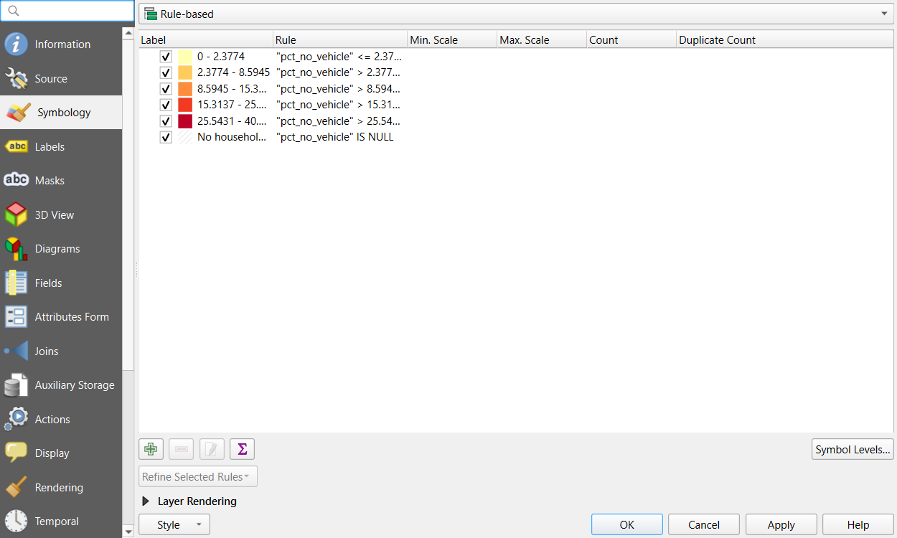
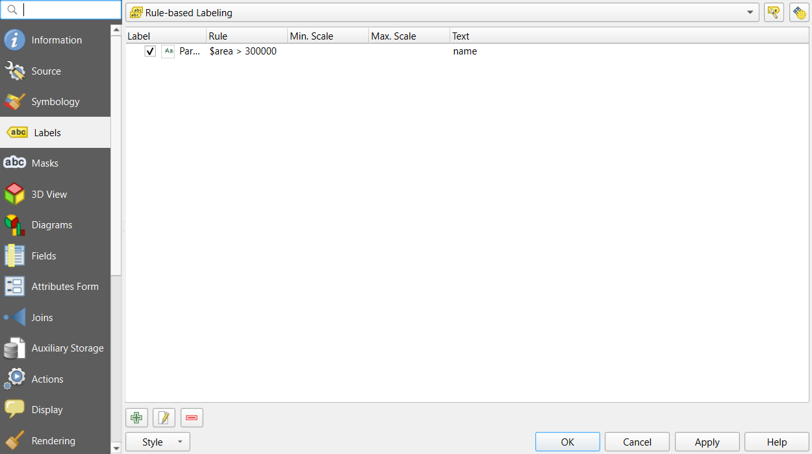
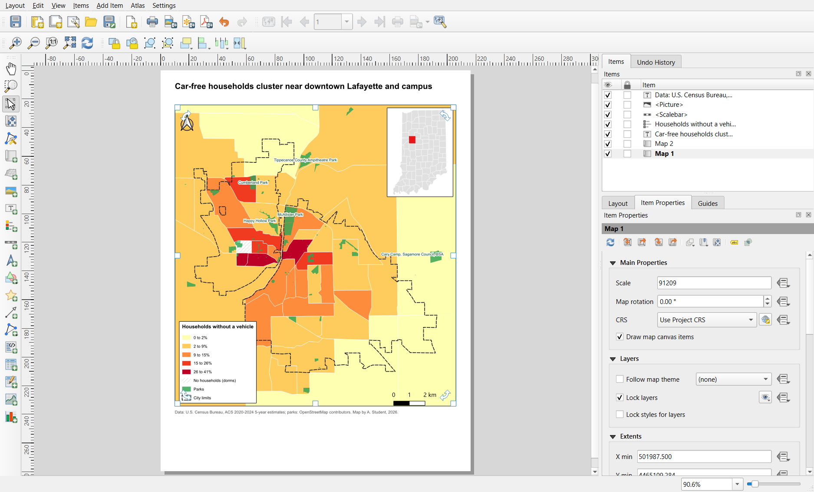
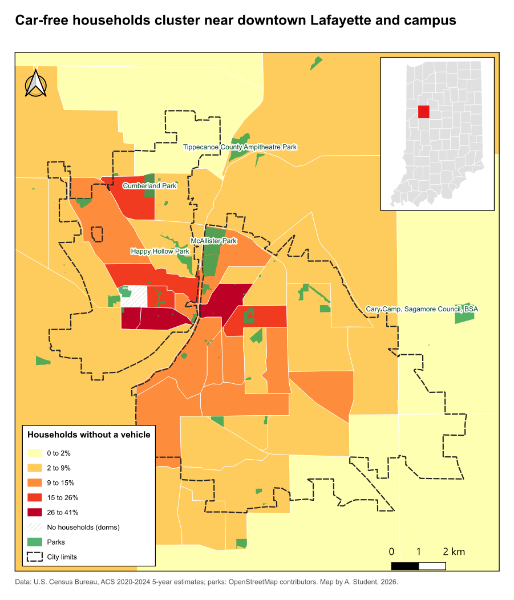

:::::::::::::::::::::::::::::::::::::: questions

- How do I turn a correct map into a finished one that others can read and print?
- How should layers, labels and a basemap be ordered and styled?
- When do small multiples need a shared scale?

::::::::::::::::::::::::::::::::::::::::::::::::

::::::::::::::::::::::::::::::::::::: objectives

- Style and order layers by their role: subject, supporting features, context and reference
- Label features legibly and by rule, with halos
- Add a basemap responsibly, a locator inset, a true scale bar and a north arrow
- Use rule-based styling and labeling, and build a print layout with a locator inset
- Export maps for print and screen

::::::::::::::::::::::::::::::::::::::::::::::::

## From a correct map to a finished map

The [Fundamentals of Map Design](mapbasics.md) episode covers what a thematic map shows: map elements,
normalization, classification and color. This episode is about **finishing**: turning a correct choropleth into
a map that a reader outside your project understands at a glance and that prints cleanly. The running example
is the share of households without a car in Lafayette and West Lafayette, Indiana, with parks and city limits on
top.

## Visual hierarchy, layer by layer

Every layer has a role, and its styling should match it:

| Role | Example | Styling |
|---|---|---|
| **Subject** | The choropleth of car-free households | Strong color, full opacity |
| **Supporting features** | Parks, city limits | Distinct but secondary: one hue, thin or dashed lines, some transparency |
| **Context** | Basemap, neighboring areas | Quiet: gray, low contrast |
| **Reference** | Labels, scale bar, north arrow, source | Small, legible, never decorative |

**Order** follows from the roles: polygons of the subject at the bottom, supporting outlines and points above
them, labels on top, and the basemap underneath everything. A layer on top of a choropleth needs either no
fill, transparency, or a strong outline so it does not hide what is underneath.

## Labels

Labels are reference information. They should be findable, legible and not in the way.

- **Label sparingly.** Label what the reader needs to orient themselves or to understand the story: the largest
  parks, the two city names. Labeling all 68 parks makes none of them readable.
- **Use a halo** (a thin outline in the background color, called a *buffer* in QGIS). It keeps text readable over
  any color and is the single most effective labeling technique.
- **Use type to signal kind.** Common conventions: italics for water and areas (rivers, parks, neighborhoods),
  upright for places and points, larger or capitalized type for more important names.
- **Place labels inside or next to their feature**, never across a boundary. For polygons, a point guaranteed to
  be inside (a "representative point" or "point on surface") is safer than the centroid, which can fall outside an
  L-shaped polygon.
- **Choose rules, not exceptions.** "Label parks over 30 hectares" is reproducible; hand-picking labels is not.

## Basemaps

A tiled basemap (OpenStreetMap, Esri, CARTO, Stamen) adds streets and place names for free, at a cost: visual
noise, a dependence on an online service, and **license conditions**. Choose a quiet, gray basemap for thematic
maps, keep its **attribution** text, and do not rely on it for print if you need full control or very high
resolution. Basemap tiles are in Web Mercator (EPSG:3857); software reprojects them to your map's CRS, which can
blur their labels slightly.

## Locator insets, scale bars and north arrows

- A **locator inset** (a small map of the state or country with the study area highlighted) answers "where is
  this?" for readers who do not know the area. It does not need a scale bar or legend of its own.
- A **scale bar** is only true on a map in a **projected** CRS with little distortion over the map (a UTM zone or
  a state plane for a county). In degrees or Web Mercator at large extents the scale changes across the map, and
  a single bar misleads.
- A **north arrow** is only essential when north is not up, but it is cheap and many readers expect one.

## Small multiples and shared scales

To compare several variables or years, repeat the same map in a grid of **small multiples**. The eye compares
patterns across panels far better than it decodes several variables in one crowded map.

Decide deliberately whether panels **share a classification**:

- **Same variable or same units** (one rate in different years, two rates you want to compare): use the **same
  class breaks and colors** in every panel, or the same dark color will mean different values.
- **Different variables** (income in dollars, children in percent): each panel needs its own classes and legend,
  and the reader compares patterns, not colors.

## Export

| Destination | Format | Notes |
|---|---|---|
| Print, a paper, a poster | **PDF** (vector) | Sharp at any size; set the page or figure size to the printed size |
| Slides, a website | **PNG** at 200 to 300 dpi | PNG keeps sharp edges; JPEG blurs lines and text |
| Further editing (Illustrator, Inkscape) | **SVG** | Every element stays editable |

Check the exported file, not just the screen: font sizes, line widths and legend spacing often look different
at print size.

---

## Hands-on: a finished map of car-free households

These steps were checked in QGIS 4.0. They build on the Foundations episodes
[Getting Started with QGIS](https://spatialturn.github.io/Foundations/qgisintro.html) (layers, symbology, print
layouts) and [Tables, Joins and Selections](https://spatialturn.github.io/Foundations/qgis-tables.html) (virtual
fields).

::::::::::::::::::::::::::::::::::::: callout

### If QGIS asks you to choose a transformation

When layers in latitude and longitude (EPSG:4326) are drawn in a project in UTM (EPSG:26916), QGIS may open a
window titled with "Multiple operations are possible for converting coordinates". For this county any of the
options is accurate to a few meters: keep the first (highlighted) one and click **OK**. QGIS remembers the choice
for the project.

::::::::::::::::::::::::::::::::::::::::::::::::

### Part 1: Load and order the layers

1. Start a new project and set its CRS to **EPSG:26916** (bottom-right corner of the window).
2. Load these with **Add Vector Layer**, **Protocol: HTTP(S)**, **Type: HTTP/HTTPS/FTP**:

   | Rename to | File |
   |---|---|
   | Tracts | `tippecanoe_tracts_acs.geojson` |
   | Parks | `tippecanoe_parks.geojson` |
   | City limits | `study_area.geojson` |
   | Indiana counties | `indiana_counties.geojson` |
   | Tippecanoe County | `tippecanoe_county.geojson` |

   Web addresses to copy:

   - **Tracts**: `https://raw.githubusercontent.com/SpatialTurn/Foundations/main/data/tippecanoe_tracts_acs.geojson`
   - **Parks**: `https://raw.githubusercontent.com/SpatialTurn/Foundations/main/data/tippecanoe_parks.geojson`
   - **City limits**: `https://raw.githubusercontent.com/SpatialTurn/CaseStudies/main/data/study_area.geojson`
   - **Indiana counties**: `https://raw.githubusercontent.com/SpatialTurn/Foundations/main/data/indiana_counties.geojson`
   - **Tippecanoe County**: `https://raw.githubusercontent.com/SpatialTurn/Foundations/main/data/tippecanoe_county.geojson`

3. Drag them into this order, top to bottom: City limits, Parks, Tracts, Tippecanoe County, Indiana counties.
   Untick the last two; they are for the locator inset.
4. Style **City limits** with no fill (**Simple Fill**, **Fill style: No Brush**) and a dark dashed outline,
   and **Parks** with a green fill, no outline and about 80% opacity (the opacity slider under the symbol).

**Check:** the dashed city outline and green parks sit on top of the tracts.

### Part 2: Rule-based styling with a "no data" class

1. Add a virtual field to **Tracts** with the Field Calculator: `pct_no_vehicle`, **Decimal (double)**,
   `"hh_no_vehicle" / "households" * 100`.
2. **Properties > Symbology:** **Graduated** on `pct_no_vehicle`, **Natural Breaks (Jenks)**, 5 classes, ramp
   **YlOrRd**, white outlines. Click **Classify**, then **Apply**.
3. Change **Graduated** to **Rule-based** at the top. QGIS converts each class into a rule with a filter such as
   `"pct_no_vehicle" > 2.38 AND "pct_no_vehicle" <= 8.59`.
4. Click the green **+**, give the new rule the filter `"pct_no_vehicle" IS NULL`, the label
   "No households (dorms)" and a light gray symbol with a hatch (**Fill style: BDiagonal**).
5. Double-click each class label and round it ("0 to 2%", "2 to 9%" and so on). Click **OK**.

{alt="Screenshot of the QGIS Layer Properties for the Tracts layer on the Symbology tab with the Rule-based renderer. Six rules are listed with their colors: five yellow to dark red classes whose filters compare pct_no_vehicle with the class limits, such as pct_no_vehicle less than or equal to 2.37, and a sixth hatched gray rule labeled No households with the filter pct_no_vehicle IS NULL."}

**Check:** the residence hall tract near campus is drawn in hatched gray instead of disappearing.

### Part 3: Labels by rule, with halos

1. **Parks > Properties > Labels:** choose **Rule-based Labeling** and click the green **+**.
2. **Filter:** `$area > 300000` (parks over 30 hectares; `$area` is in square meters). **Value:** `name`.
3. In the rule's **Text** tab set the size to about 8 points and a dark green color; in the **Buffer** tab tick
   **Draw text buffer**, size 1 mm, white. That buffer is the halo.
4. Click **OK** twice.

{alt="Screenshot of the QGIS Layer Properties for the Parks layer on the Labels tab with Rule-based Labeling. One rule is listed: it is ticked, its filter reads area greater than 300000, and its text is the name field."}

**Check:** six parks are labeled, each with a white halo. If no labels appear and the numbers in the
**Preview** of `$area` look far too large, open **Project > Properties > General** and set **Ellipsoid** to
**WGS 84**, which is how QGIS measures `$area`.

Add the two city names as labels in the layout later, or as a small point layer: places are often labeled by
hand, in italics.

### Part 4: A layout with a locator inset

1. **Project > New Print Layout**, page size **Letter** (Layout tab, right panel, after right-clicking the
   page and choosing **Page Properties**).
2. **Main map:** **Add Item > Add Map**, drawn over most of the page. Zoom it to the cities with the
   **Move Item Content** tool and the mouse wheel. In **Item Properties > Layers**, tick **Lock layers** so the
   map keeps today's layers.
3. **Locator:** in the main QGIS window, tick only **Indiana counties** and **Tippecanoe County** (styled gray and
   red) and zoom to Indiana. Back in the layout, add a second, small map in a corner; tick **Lock layers** for it
   too. Then turn the city layers back on in the main window.
4. In the locator's **Item Properties > Overviews**, click **+** and set **Map frame** to the main map (Map 1). A
   rectangle shows where the main map is.
5. Add the title (stating the finding), a legend (untick **Auto update**, remove the county layers, and in the
   legend panel hide the "Tracts" group heading if you like), a scale bar in kilometers, a north arrow and a
   source line, as in the Foundations episode.

{alt="Screenshot of the QGIS Print Layout window. A Letter page holds the title Car-free households cluster near downtown Lafayette and campus, the main map of Lafayette tracts in yellow to dark red with green parks and a dashed city boundary, a small locator map of Indiana in the upper right with Tippecanoe County in red, a north arrow at the upper left, a legend at the lower left, a scale bar of 0 to 2 km at the lower right and a source line below the map. The Items panel lists the source label, picture, scale bar, legend, title, Map 2 and Map 1; Item Properties for Map 1 show Lock layers ticked."}

### Part 5: Export

1. **Layout > Export as PDF** for print (vector, sharp at any size).
2. **Layout > Export as Image** for screens: PNG, with **Export resolution** 200 to 300 dpi.
3. Open both files and check sizes, fonts and the legend.

{alt="Finished map titled Car-free households cluster near downtown Lafayette and campus. Census tracts of Lafayette and West Lafayette are shaded yellow to dark red by the share of households without a vehicle, darkest near downtown Lafayette and the Purdue campus, with one hatched gray tract with no households. Green parks are drawn on top, six of them labeled with white halos, and a dashed line marks the city limits. A locator map of Indiana in the upper right shows Tippecanoe County in red. A legend at the lower left lists 0 to 2, 2 to 9, 9 to 15, 15 to 26 and 26 to 41 percent, no households, parks and city limits. A north arrow, a 0 to 2 km scale bar and a source line complete the layout."}

::::::::::::::::::::::::::::::::::::: callout

### One layout, many maps: atlas

The layout **Atlas** (Atlas menu in the layout window) repeats a layout once per feature of a coverage layer,
for example one page per tract or per county, and exports them all at once. It is the QGIS way to make dozens of
consistent maps.

::::::::::::::::::::::::::::::::::::::::::::::::

---

:::::::::::::::::::::::::::::::::::: challenge

## Challenge 1: What is wrong with this map?

A map of poverty rates by tract uses a satellite basemap at full opacity, red and green classes, labels for every
street, a scale bar on a Web Mercator map of the whole United States, and no source line. List the problems and
a fix for each.

:::::::::::::::: solution

- Satellite basemap: too busy for a thematic map; use a quiet gray basemap or none, and keep the attribution.
- Red and green classes: unreadable for many readers with color vision deficiency, and a diverging scheme for a
  one-directional rate; use a sequential palette (see the Accessibility episode).
- Labels for every street: clutter; label only what orients the reader.
- Scale bar on a national Web Mercator map: the scale varies greatly with latitude; drop it or use an equal-area
  projection and a note.
- No source line: add the dataset and year.

:::::::::::::::::::::::::

::::::::::::::::::::::::::::::::::::::::::::::::

:::::::::::::::::::::::::::::::::::: challenge

## Challenge 2: Two maps, one scale

Make a second layout page (or a second layout) with two maps side by side: car-free households and the poverty
rate (`"below_poverty" / "poverty_universe" * 100`). Should they share classes? Set them up accordingly.

:::::::::::::::: solution

Both are percentages and the point is to compare them, so **share the classes**: in both layers use **Graduated**
with **Mode: Fixed Interval** or manual breaks (edit the values) at 10, 20, 40 and 60%, with the same ramp. Use
**Lock layers** and **Lock styles for layers** in each map item so each keeps its own layer. One legend is
enough. With shared classes it is obvious that poverty rates reach much higher than car-free rates.

:::::::::::::::::::::::::

::::::::::::::::::::::::::::::::::::::::::::::::

::::::::::::::::::::::::::::::::::::: keypoints

- Style each layer by its role; the subject is strong, context is quiet
- Convert Graduated to Rule-based to add a "no data" rule; label by rule with a text buffer (halo)
- A second map item with an Overview makes a locator inset; Lock layers keeps each map's content
- Scale bars need a projected CRS; small multiples share classes only for comparable values
- Export PDF for print and PNG at 200 to 300 dpi for screens, and check the exported file

::::::::::::::::::::::::::::::::::::::::::::::::
