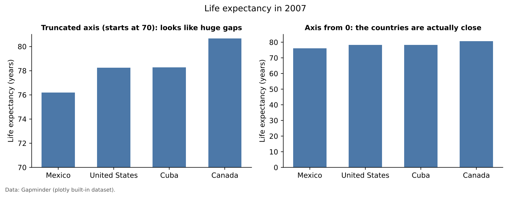

:::::::::::::::::::::::::::::::::::::: questions

- What is data visualization, and why does it matter for research?
- What can a chart or map show that a table cannot?
- How can a visualization mislead, even when the data are correct?
- How do exploratory and explanatory visualizations differ?
- Which tools are a good fit for beginners, and which come later?

::::::::::::::::::::::::::::::::::::::::::::::::

::::::::::::::::::::::::::::::::::::: objectives

- Define data visualization and explain its purpose in research
- Describe the main advantages and risks of visualizing data
- Tell exploratory visualizations apart from explanatory ones
- Recognize common ways charts and maps mislead
- Compare tools for making charts and maps, from spreadsheets to Python and QGIS
- Apply a short set of design principles to your own figures

::::::::::::::::::::::::::::::::::::::::::::::::

## What is data visualization?

**Data visualization** is the graphical representation of data. Instead of reading rows and
columns of numbers, the reader sees positions, lengths, areas, colors and shapes, and uses them to
compare values, spot patterns and notice anything unusual.

A good visualization answers a question. "How did unemployment change after 2008?", "Which counties
have the most people over 65?" or "Is income related to commute time?" are all questions a chart or a
map can answer faster and more memorably than a table.

Maps are a special kind of visualization: they use **location** as one of the visual channels. Most of
this module is about maps, but the same principles apply to every chart, so we start there.

## Why visualize?

1. **Patterns are easier to see than to read.** Our visual system is very good at comparing
   positions and lengths, noticing clusters, and picking out a value that does not fit. A trend
   across 50 monthly figures is obvious in a line chart and easy to miss in a table.
2. **Visuals reveal what summary statistics hide.** Very different datasets can share the same
   mean, variance and correlation and still look nothing alike when plotted. (Anscombe's quartet is
   the classic example; search for it if you have not seen it.)
3. **They catch data problems.** Impossible values, missing records, duplicated rows and wrong units
   often show up immediately in a quick plot.
4. **They communicate.** A clear figure lets colleagues, community partners and policymakers grasp a
   result without reading your code or your tables.

### Exploratory and explanatory visualization

- **Exploratory** figures are for *you*. They are quick, often rough, and you make many of them while
  you get to know your data.
- **Explanatory** figures are for *others*. They carry one clear message, with a title that states it,
  labeled axes, units, a legend and a data source.

Most of the figures in a research project are exploratory. The few that reach a paper, poster or
report should be carefully designed explanatory figures.

## Advantages and risks

| Advantages | Risks |
|---|---|
| Fast comparison of many values | A misleading scale can exaggerate or hide differences |
| Reveals trends, clusters and outliers | Too much decoration ("chartjunk") adds noise, not information |
| Exposes data quality problems | The wrong chart type can suggest relationships that are not there |
| Communicates across expertise levels | Poor color choices exclude readers with color vision deficiency |
| Makes results memorable | A polished figure can make weak evidence look convincing |

::::::::::::::::::::::::::::::::::::: callout

### How a correct chart can still mislead

The two bar charts below show exactly the same numbers. On the left, the vertical axis starts at 70,
which makes the differences between countries look enormous. On the right, the axis starts at 0, and
the countries turn out to be quite similar.

{alt="Two bar charts of 2007 life expectancy for Mexico, the United States, Cuba and Canada. The left chart's axis starts at 70 years, so Canada's bar looks about three times taller than Mexico's. The right chart's axis starts at 0, and all four bars look nearly the same height, between 76 and 81 years."}

Bar charts should almost always start at zero, because readers compare bar lengths. Line charts and
dot plots can start elsewhere, because readers compare positions, but the axis must be clearly
labeled.

::::::::::::::::::::::::::::::::::::::::::::::::

## Big data and visualization

Large datasets make visualization more important, not less:

- **Volume.** Nobody can read a million rows, but a histogram, density plot or map can show the whole
  distribution at once.
- **Variety.** Combining tables, text and locations often calls for layered figures, such as a map
  with a chart beside it.
- **Many variables.** With dozens of variables, small multiples (many small, identical charts, one per
  group) or scatterplot matrices let you compare them systematically.
- **Interactivity.** Zooming, filtering and hover tooltips let readers explore data that would
  overwhelm a static figure.

Large datasets also bring practical problems. Plotting millions of points can be slow and produce a
solid blob of ink. Sampling, aggregating (for example into hexagons or counties) and transparency are
the usual remedies.

## Common chart types and what they are for

| Question | Chart type |
|---|---|
| How does a value change over time? | Line chart |
| How do categories compare? | Bar chart (horizontal if labels are long) |
| How are values distributed? | Histogram, box plot |
| Are two numeric variables related? | Scatter plot |
| How do many variables relate to each other? | Correlation heatmap, scatterplot matrix |
| How does a whole divide into parts? | Stacked bar; pie chart only for 2 or 3 parts |
| Where does something happen? | Map (choropleth, proportional symbols, dots; see the map episodes) |

## Tools

| Tool | Good for | Cost | In this curriculum |
|---|---|---|---|
| Excel or Google Sheets | Quick bar and line charts | Free or licensed | Not covered |
| Tableau Public | Interactive dashboards without code | Free public version | Not covered |
| **Python** (Matplotlib, Seaborn, Plotly, GeoPandas) | Reproducible charts and maps, from quick to publication quality | Free, open source | **The notebooks in this episode** |
| **QGIS** | Desktop mapping and cartographic layouts | Free, open source | **The Foundations module's [Getting Started with QGIS](https://spatialturn.github.io/Foundations/qgisintro.html) episode** |
| R (ggplot2, tmap, sf) | Statistical graphics and maps | Free, open source | Not covered |
| JavaScript (D3, Leaflet) | Custom interactive web graphics | Free, open source | Not covered |

We use **Python in Google Colab** for charts and simple maps, and **QGIS** for designed maps, because
both are free and widely used in the social sciences.

## Principles of effective visualization

These principles come from the work of Edward Tufte, William Cleveland, Alberto Cairo and others.

1. **Start with the question.** Decide what the figure should show before choosing a chart type.
2. **Choose the right chart type** for that question (see the table above).
3. **Label everything.** A title that states the message, axis labels with units, a legend and a
   data source.
4. **Be honest with scales.** Start bar charts at zero, and say clearly when an axis does not.
5. **Remove clutter.** Delete anything that does not help the reader: heavy gridlines, 3D effects,
   background images, redundant labels.
6. **Use color with purpose.** Color should encode data or draw attention, not decorate. Use
   colorblind safe palettes such as viridis or ColorBrewer schemes.
7. **Prefer small multiples to crowded charts.** Several simple panels beat one chart with ten lines.
8. **Never put two unrelated scales on one axis.** Temperature and rainfall belong in two panels, not
   on one shared y-axis.
9. **Make it accessible.** Add alt text, keep good contrast, and do not rely on color alone.

## Ethics

Visualizations influence decisions about funding, policy and people's lives.

- Do not cherry pick time windows, places or subsets to support a conclusion.
- State your data source and its limitations.
- Protect privacy. Maps of individual addresses or small areas can identify people.
- Be careful with sensitive topics such as health, crime or immigration. How you classify and color
  data can stigmatize places and the people who live there.

## Practice

Work through the notebooks below in Google Colab. Click **File > Save a copy in Drive** first so you
can save your changes.

:::::::::::::::::::::::::::::::::::: challenge

## Challenge 1: Exploratory or explanatory?

For each figure, decide whether it is exploratory or explanatory:

1. A quick histogram you make to check whether income values look reasonable.
2. A map of county vaccination rates in a public health department press release.
3. A scatterplot matrix of ten survey variables you look at before choosing a model.

:::::::::::::::::::::::: solution

1. Exploratory: it is for you, to check the data.
2. Explanatory: it carries one message to a general audience, so it needs a clear title, legend,
   source and careful color choices.
3. Exploratory: it helps you decide what to analyze next.

:::::::::::::::::::::::::::::::::
::::::::::::::::::::::::::::::::::::::::::::::::

:::::::::::::::::::::::::::::::::::: challenge

## Challenge 2: Spot the problems

A colleague shows you a 3D pie chart with 12 slices in rainbow colors, no title and no labels, showing
the share of survey respondents in each of 12 age groups. List at least four problems and suggest a
better chart.

:::::::::::::::::::::::: solution

- 3D distorts slice sizes: front slices look bigger than back slices.
- Twelve slices are too many to compare by angle.
- Rainbow colors have no order, even though age groups do, and some colors are hard to tell apart for
  people with color vision deficiency.
- No title, labels or percentages, so the reader cannot tell what is shown.

A better choice is a **bar chart** (or histogram) of the 12 age groups in order, in a single color,
with a title, labeled axes and the survey source.

:::::::::::::::::::::::::::::::::
::::::::::::::::::::::::::::::::::::::::::::::::

## Notebooks

| Level | Notebook | What you will do |
|---|---|---|
| Beginner |  | Build line and bar charts, then fix common problems: missing labels, truncated axes, wrong chart type, too many colors |
| Intermediate |  | Distributions, scatter plots, small multiples, correlation heatmaps and interactive charts |
| Advanced |  | Choropleth maps, normalization, classification methods, colorblind safe palettes and interactive maps |

The notebooks use datasets built into Plotly, so they need no download or account. Notebook 1c also
offers an optional section for learners with a free Census API key.

::::::::::::::::::::::::::::::::::::: keypoints

- Data visualization turns numbers into positions, lengths, areas and colors that people can compare
  quickly.
- Exploratory figures help you understand your data; explanatory figures communicate one message to
  others.
- Correct data can still mislead through truncated axes, the wrong chart type or poor color choices.
- Choose the chart type from the question, label everything, and keep scales honest.
- Python and QGIS are free tools that cover charts, maps and cartographic layouts.

::::::::::::::::::::::::::::::::::::::::::::::::
