:::::::::::::::::::::::::::::::::::::: questions

- What makes a map effective?
- How do visual hierarchy and visual variables guide a reader?
- How should colors be chosen for different kinds of data?
- What are map scale and projections, and why do they matter?
- Which thematic map type suits which data?
- Why should counts usually be converted to rates before mapping?
- How does the classification method change what a map shows?

::::::::::::::::::::::::::::::::::::::::::::::::

::::::::::::::::::::::::::::::::::::: objectives

- Identify the core elements of a map layout
- Apply visual hierarchy and visual variables to improve clarity
- Choose sequential, diverging or categorical color schemes appropriately
- Explain map scale and the trade-offs between projections
- Select a thematic map type that fits the data
- Normalize counts into rates where appropriate
- Compare six classification methods and choose one deliberately
- Find the equivalent tools in Python and QGIS

::::::::::::::::::::::::::::::::::::::::::::::::

## What is a map?

A **map** is a visual representation of spatial data designed to communicate information about
locations, patterns and relationships. Like any figure, it is a **communication tool**, not just a
picture.

A good map:

- Has a clear purpose
- Represents the data accurately
- Is easy to read and interpret
- Avoids misleading elements
- **Includes the map elements the reader needs**

### Map elements

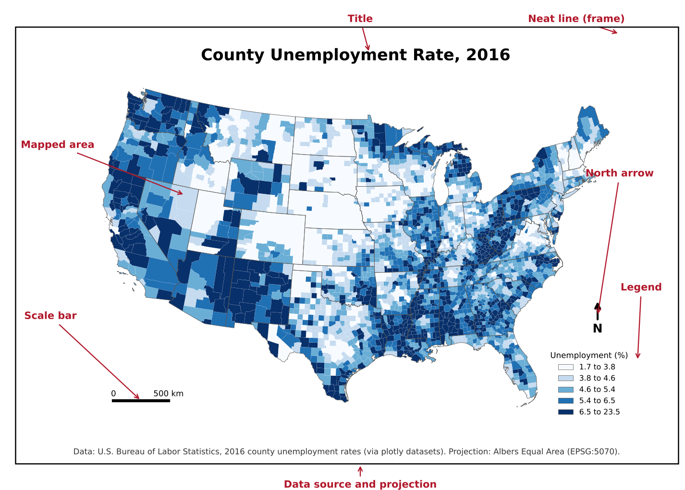{alt="A county map of 2016 unemployment rates in the contiguous United States, shaded in five blue classes, inside a black frame. Red labels with arrows identify each layout element: the title at the top, the mapped area, the legend at lower right, the north arrow, the scale bar at lower left, the data source and projection line at the bottom, and the neat line, which is the frame around the layout."}

| Element | Purpose | Always needed? |
|---|---|---|
| **Title** | States what the map shows (ideally its message) | Yes |
| **Mapped area** | The data itself | Yes |
| **Legend** | Explains colors, symbols and units | Yes, unless there is a single obvious symbol |
| **Data source** | Lets readers check and trust the data | Yes |
| **Scale bar** | Shows distance | When distance matters (local and regional maps) |
| **North arrow** | Shows orientation | When north is not up or orientation is unclear |
| **Projection note** | States the coordinate system | For technical audiences |
| **Neat line** | A frame that groups the elements | Optional |
| **Inset map** | Shows location in a wider area, or distant parts such as Alaska and Hawaii | When needed |

::::::::::::::::::::::::::::::::::::: callout

### Key idea

Every element should earn its place. A north arrow on a world map in a familiar projection adds
nothing; a missing legend makes a map unreadable.

::::::::::::::::::::::::::::::::::::::::::::::::

---

## Visual hierarchy

Visual hierarchy controls what the reader sees first, second and last.

**Tools for creating hierarchy:**

- **Size:** larger elements draw attention first
- **Lightness and contrast:** strong contrast with the background stands out
- **Color saturation:** vivid colors stand out against muted ones
- **Position:** elements near the center or top are noticed early

**A typical hierarchy:**

1. The data layer: strongest colors and contrast
2. Title and legend: clear but not overpowering
3. Labels: readable, but secondary to the data
4. Basemap, boundaries and other context: muted greys and thin lines

:::::::::::::::::::::::::::::::::::: challenge

## Challenge 1: What do you see first?

Look at the map elements figure above. What do you notice first, second and third? Is that the order
the mapmaker would want?

:::::::::::::::::::::::: solution

Most readers notice the dark blue counties first (the data), then the large title, then the legend.
That is the intended order: the data and its message come first, and the legend explains them. The red
annotation labels are added for this lesson and would not appear on a real map.

:::::::::::::::::::::::::::::::::
::::::::::::::::::::::::::::::::::::::::::::::::

---

## Visual variables

**Visual variables** are the properties of a symbol that can change to represent data. The idea comes
from the cartographer Jacques Bertin.

| Visual variable | Good for | Example |
|---|---|---|
| Position | Location (on maps, this is fixed by geography) | Where a city is |
| Size | Quantities | City population as circle size |
| Lightness (value) | Ordered data, low to high | Unemployment rate as light to dark |
| Hue | Categories | Land use type |
| Shape | Categories (points) | Airport type |
| Orientation and texture | Categories, secondary encoding | Hatching for uncertain values |

The key rule: **use ordered variables (size, lightness) for ordered data, and unordered variables
(hue, shape) for categories.** Using different hues for low to high values forces the reader to keep
looking at the legend.

---

## Colors on maps

There are three kinds of color scheme, one for each kind of data.

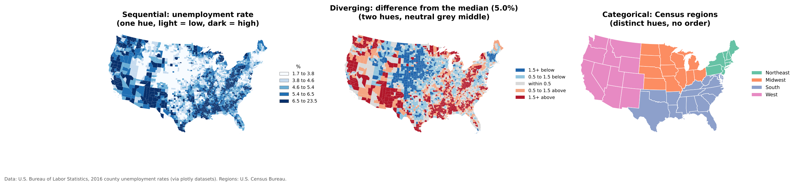{alt="Three maps of the contiguous United States. Left, sequential: county unemployment rates in five shades of blue from very light to dark. Middle, diverging: each county's unemployment rate compared with the national county median of 5.0 percent, with dark and light blue below the median, grey within half a point, and light and dark red above. Right, categorical: states colored by Census region in four distinct colors, green for Northeast, orange for Midwest, purple-blue for South and pink for West."}

| Scheme | Use for | How it looks | Example palettes |
|---|---|---|---|
| **Sequential** | Values from low to high | One hue, light to dark | Blues, Greens, viridis, YlGnBu |
| **Diverging** | Values above and below a meaningful midpoint (zero, an average, 50%) | Two hues meeting at a neutral light middle | RdBu, BrBG, PuOr |
| **Categorical** | Groups with no order | Distinct hues of similar lightness | Set2, Dark2, Tableau 10 |

**Best practices:**

- Light colors for low values and dark colors for high values (most readers assume dark means more).
- Use a diverging scheme only when the midpoint means something. The middle map above uses the national
  median, so it answers "is this county above or below typical?"
- Avoid rainbow palettes for ordered data; they have no natural order and create false boundaries.
- Avoid red and green together; see the Accessibility episode.
- Five to seven classes is usually the most a reader can tell apart.

[ColorBrewer](https://colorbrewer2.org/) is a free tool for choosing map palettes, including
colorblind safe ones. The same palettes are built into QGIS and Python.

---

## Scale

**Map scale** is the relationship between a distance on the map and the same distance on the ground,
for example 1:24,000 (one inch on the map is 24,000 inches, or 2,000 feet, on the ground).

- **Large-scale maps** show a **small area** in high detail, such as a city map (1:10,000).
- **Small-scale maps** show a **large area** with less detail, such as a world map (1:50,000,000).

The terms feel backwards at first: 1/10,000 is a larger fraction than 1/50,000,000, so the city map has
the larger scale.

Scale matters because it determines how much detail can be shown and which patterns are visible. A
pattern that is clear across counties may disappear, or reverse, at the tract level.

---

## Projections

The Earth is round; maps are flat. A **projection** is a mathematical method for flattening the Earth,
and every projection distorts at least one of **area, shape, distance or direction**.

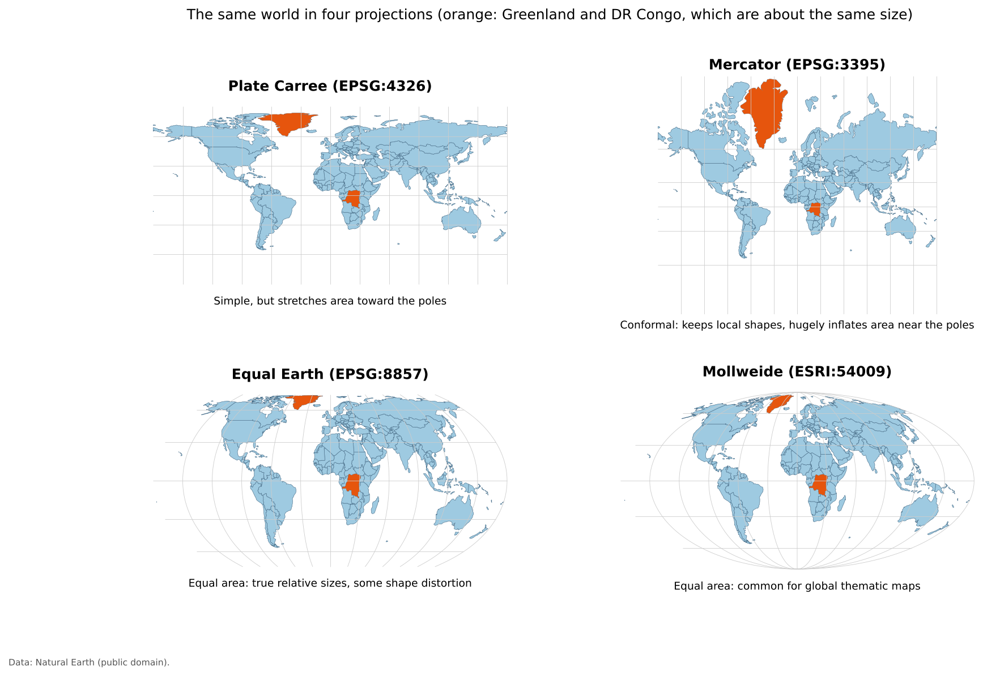{alt="Four world maps in different projections, with Greenland and the Democratic Republic of the Congo colored orange; the two countries have about the same land area. In Plate Carree, Greenland looks larger than the Congo. In Mercator, Greenland looks many times larger than the Congo and the far north is greatly stretched. In Equal Earth and Mollweide, both of which preserve area, Greenland and the Congo appear about the same size, and the continents' outlines curve toward the edges."}

| Projection family | Preserves | Typical use |
|---|---|---|
| **Equal area** (Albers, Equal Earth, Mollweide) | Relative area | Thematic maps of rates or densities; **use these for choropleth maps** |
| **Conformal** (Mercator, Lambert Conformal Conic) | Local shapes and angles | Navigation, web map tiles, large-scale local maps |
| **Equidistant** (Azimuthal Equidistant) | Distance from one point | Distance or flight range maps |
| **Compromise** (Robinson, Winkel Tripel) | Nothing exactly, everything approximately | General reference world maps |

Web maps (Google Maps, OpenStreetMap) use **Web Mercator**, which is why Greenland and Russia look
enormous online. For thematic maps of the United States, the **USA Contiguous Albers Equal Area**
projection (EPSG:5070) is a common choice; it is used for the U.S. maps in this lesson.

Try [The True Size Of](https://thetruesize.com/) to drag countries north and south on a Mercator map
and see how much their apparent size changes. Drag Russia down to the equator and compare it with
Africa.

::::::::::::::::::::::::::::::::::::: callout

### Important

There is no perfect projection, only projections suited to particular purposes. When a map compares
areas or densities, use an equal area projection.

::::::::::::::::::::::::::::::::::::::::::::::::

This section is about choosing a projection for a map. For coordinate reference systems as part of your
data (datums, EPSG codes, and the difference between defining and reprojecting a layer), see the Data
Management module's [Coordinate Reference Systems](https://spatialturn.github.io/DataManagement/crs.html) episode.

---

## Labels and legends

**Labels:**

- Readable size and font; avoid overlap
- Use hierarchy: larger text for more important places
- Add a light halo or outline when labels sit on top of busy backgrounds

**Legends:**

- Explain every color and symbol
- Include units ("percent", "people per square mile")
- Use readable, rounded class breaks where possible
- Order classes from low to high, matching the color order

---

## Thematic map types

### Choropleth maps

A **choropleth map** shades areas (states, counties, tracts) by a data value.

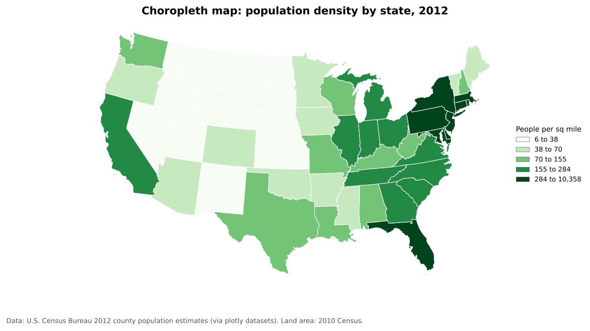{alt="Choropleth map of the contiguous United States with states shaded in five green classes by 2012 population density. The darkest states, with more than 284 people per square mile, are in the Northeast and Florida. The lightest, with fewer than 38 people per square mile, are in the Great Plains and Mountain West."}

**Best for:** rates, ratios and densities (percent, per capita, per square mile).
**Avoid:** raw counts, because large areas and large populations dominate the map (see Normalization
below).

### Proportional symbol maps

**Proportional symbol maps** place a symbol, usually a circle, at each location and size it by a value.

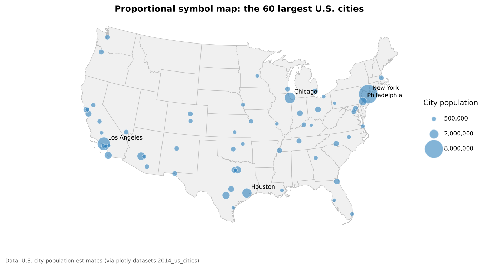{alt="Map of the contiguous United States with blue circles sized by population for the 60 largest cities. New York has by far the largest circle, followed by Los Angeles and Chicago. A legend shows circle sizes for 500,000, 2 million and 8 million people."}

**Best for:** counts and magnitudes at points, or counts for areas when you want to avoid the
choropleth problem with raw counts. Scale the circle's **area**, not its radius, to the value.

### Dot density maps

**Dot density maps** place one dot for a fixed number of things (people, households, cases) inside each
area.

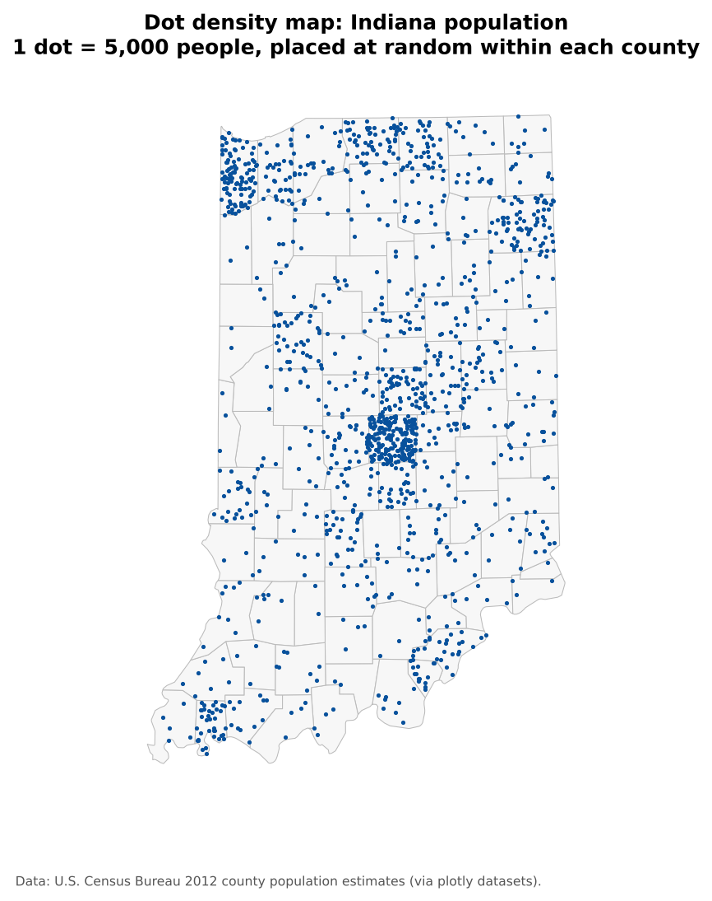{alt="Map of Indiana's 92 counties with blue dots, each representing 5,000 people, placed randomly within each county. Dots are densest around Indianapolis in the center, the Chicago suburbs in the northwest corner, Fort Wayne in the northeast and South Bend in the north, and sparse across rural counties."}

**Best for:** showing how a count is distributed. Remember that dots are placed at random inside each
area; they do not show exact locations.

### Cartograms

A **cartogram** resizes areas according to a data value. In a **non-contiguous cartogram**, each area
keeps its shape but is shrunk (or grown) in place, so gaps open between neighbors.

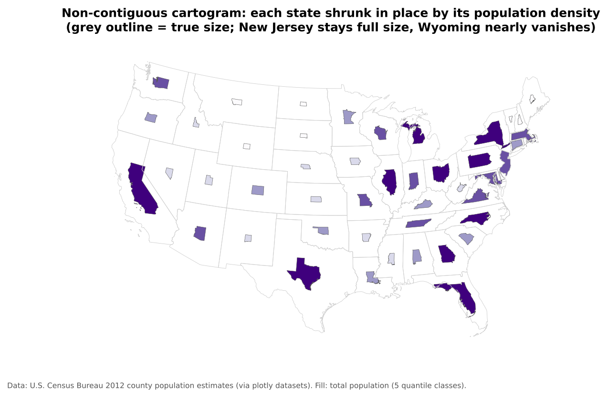{alt="Non-contiguous cartogram of the contiguous United States. Grey outlines show each state's true size. Inside each outline, the state is redrawn smaller in proportion to its population density and shaded purple by total population. Dense eastern states such as New Jersey stay close to full size, while western states such as Wyoming and Montana shrink to tiny shapes."}

**Best for:** emphasizing magnitude over geographic area, for example showing that large but sparsely
populated states hold few people. Other types, such as contiguous and Dorling cartograms, distort shapes
or replace them with circles.

### Multivariate maps

A **multivariate map** shows two or more variables at once, usually with different visual variables.

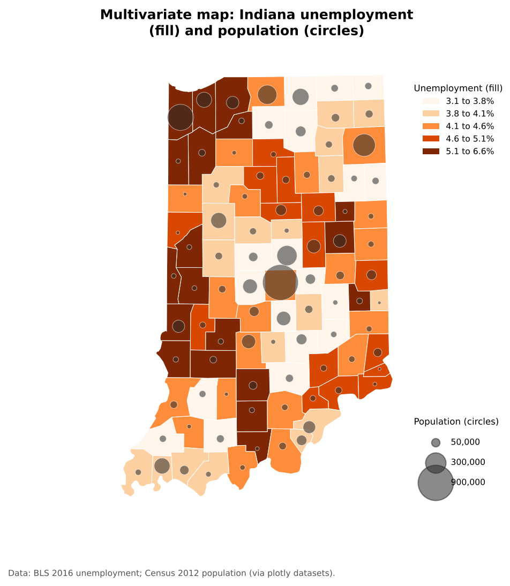{alt="Map of Indiana counties shaded in five orange classes by 2016 unemployment rate, with grey circles sized by population on top. The largest circle is Marion County (Indianapolis). Several northwestern counties near Chicago have both large circles and dark orange shading."}

**Best for:** exploring relationships between variables. Combine different visual variables (fill
lightness for one, symbol size for another) rather than two sets of colors. Keep it to two or three
variables, or the map becomes hard to read.

---

## Normalization: counts versus rates

**Normalizing** means dividing a count by something that accounts for size: population, households,
land area or the total of a group. It turns "how many?" into "how common?".

Choropleth maps of raw counts mostly show where many people live. The two maps below show the same
data:

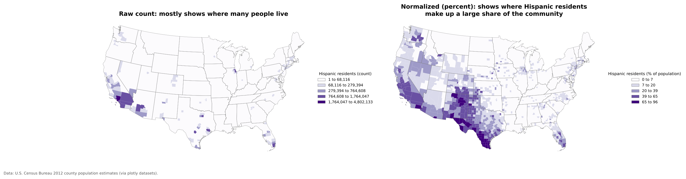{alt="Two county maps of the contiguous United States. Left: number of Hispanic residents, where almost every county is in the lightest class and only a few large counties stand out, such as Los Angeles, Harris County (Houston), Cook County (Chicago) and Miami-Dade. Right: Hispanic residents as a percent of county population, showing broad regions with high shares across South and West Texas, New Mexico, Southern California and Arizona, along with scattered counties in the Great Plains, Washington and Florida."}

The count map (left) highlights a few very populous counties. The percent map (right) shows where
Hispanic residents make up a large share of the community, a different and usually more useful
question.

**Common normalizations:**

| Count | Divide by | Result |
|---|---|---|
| People | Land area | Population density (people per sq mile) |
| People in a group | Total population | Percent of population |
| Cases, crimes, events | Population | Rate per 1,000 or 100,000 |
| Households without a car | All households | Percent of households |

::::::::::::::::::::::::::::::::::::: callout

### Rule of thumb

Use **rates** on choropleth maps. If you need to show **counts**, use proportional symbols or dot
density instead.

::::::::::::::::::::::::::::::::::::::::::::::::

---

## Static and interactive maps

**Static maps** are fixed images. They suit print and reports, and give you full control of the
design. All of the maps in this episode are static.

**Interactive (web) maps** let readers zoom, pan, toggle layers and click or hover for details. They
suit exploration and large datasets, but take more effort to build and to design well.

For an example, open the [Workshop 2026 page](https://spatialturn.github.io/workshop2026.html) on this
site and scroll down to the interactive map of the workshop location. In Python, a single line,
`gdf.explore()`, turns a GeoDataFrame into an interactive web map (see notebook 1c).

::::::::::::::::::::::::::::::::::::: callout

### Guideline

Use interactive maps when readers need to explore. Use static maps when you want to communicate one
message clearly.

::::::::::::::::::::::::::::::::::::::::::::::::

---

## Data classification

Most choropleth maps group values into a few **classes**, each with one color. How you choose the class
breaks can change the story the map tells. The six maps below show exactly the same data, Indiana
population density by county, classified six ways.

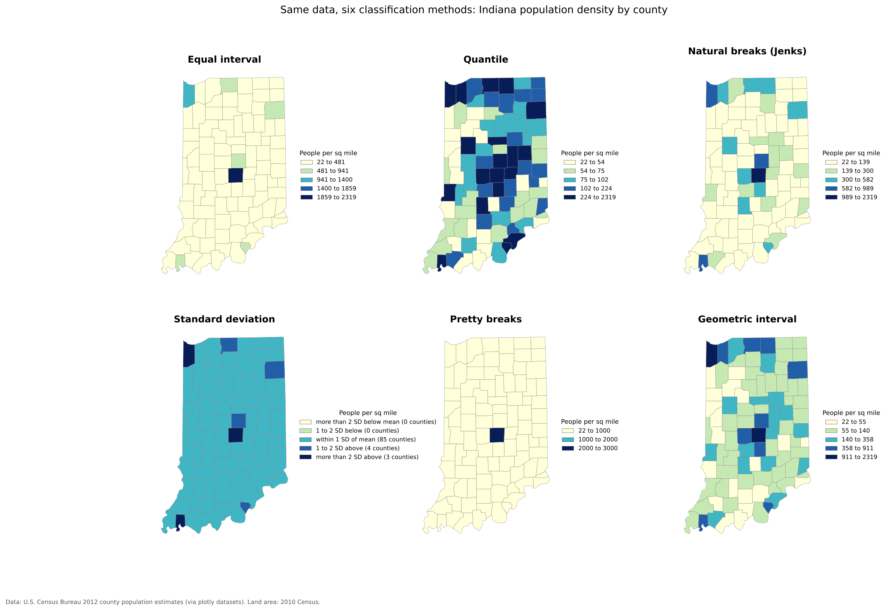{alt="Six maps of Indiana counties shaded by population density, one for each classification method. Equal interval: almost every county is in the lightest class, with only Marion County (Indianapolis) dark. Quantile: counties are spread evenly across five classes, so many rural counties look dark. Natural breaks: a few urban counties stand out in darker classes, most counties are light. Standard deviation: 85 of 92 counties fall within one standard deviation of the mean, with only a few above. Pretty breaks: only three classes with round numbers, and nearly every county in the first. Geometric interval: a gradual spread of shades that separates rural counties from each other and from urban counties."}

### The six methods

**Equal interval** divides the range of values into classes of equal width (for example 0 to 500, 500
to 1,000). It is easy to read and good for evenly spread data, but with skewed data, as here, almost
every area lands in the first class.

**Quantile** puts the same number of areas in each class (here, about 18 counties per class). Every
color is used equally, which is good for ranking ("top fifth of counties"), but very different values
can share a class, and similar values can be split apart.

**Natural breaks (Jenks)** finds breaks that minimize differences within classes and maximize
differences between them. It follows the natural clusters in the data and often gives a faithful
picture of one map. Because the breaks depend on the data, the same method gives different breaks for
different years or places, so maps are hard to compare.

**Standard deviation** shows how far each value is from the mean (for example, "more than 1 standard
deviation above"). It is useful when the question is "how unusual is this place?" and best paired with
a diverging palette. With skewed data like this, most areas fall in the middle class.

**Pretty breaks** uses round, easy to read numbers (0, 1,000, 2,000). Readers like round numbers, but
the breaks may not match the shape of the data.

**Geometric interval** makes each class a constant multiple wider than the last. It suits strongly
skewed data, such as population density or income, where most values are small and a few are very
large.

You can also set **manual breaks** at meaningful values, such as the poverty line or a policy
threshold, which is often the best choice for maps that inform decisions.

### Where the breaks fall

A histogram with the class breaks drawn on it shows why the maps look so different:

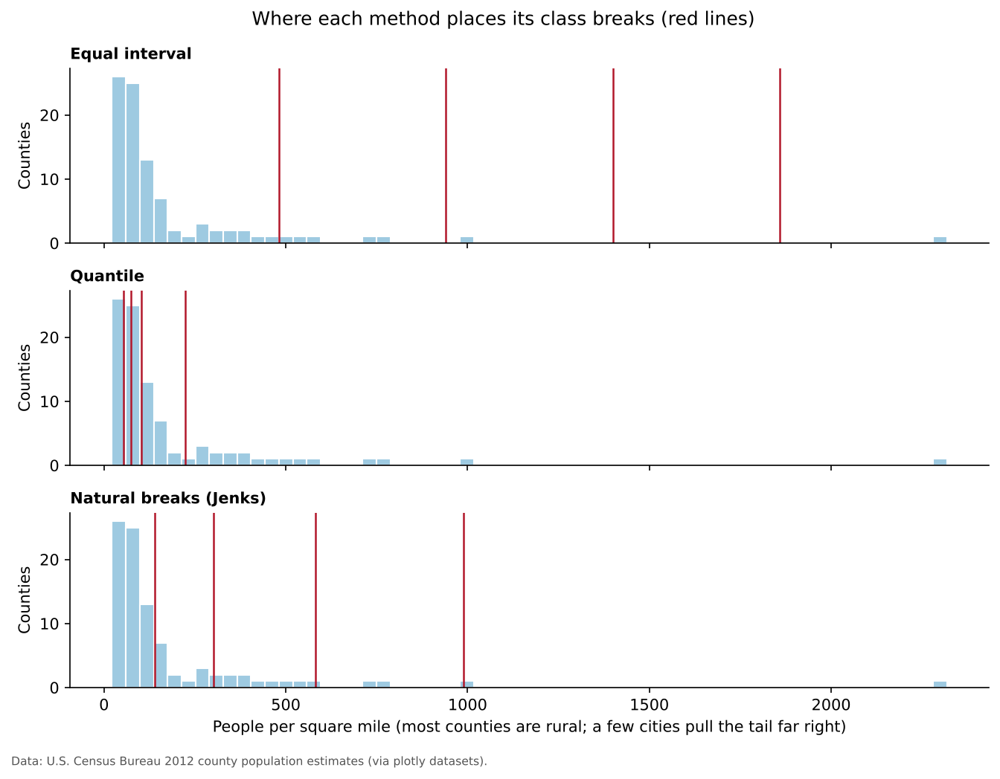{alt="Three histograms of Indiana county population density, each with red vertical lines marking class breaks. Most counties have fewer than 200 people per square mile, with a long tail to one county above 2,000. Equal interval breaks are spaced evenly from about 480 to 1,860, leaving almost all counties below the first break. Quantile breaks are clustered between about 54 and 224, within the main body of the data. Natural breaks fall at about 139, 300, 582 and 989."}

### Choosing a method

| Method | Best use | Watch out for |
|---|---|---|
| Equal interval | Evenly spread data; familiar ranges such as percentages | Skewed data puts nearly everything in one class |
| Quantile | Rankings and comparisons ("top 20%") | Similar values split; different values grouped |
| Natural breaks | Showing clusters in one dataset | Breaks are hard to compare across maps |
| Standard deviation | How unusual each area is | Readers must understand standard deviation |
| Pretty breaks | General audiences | Breaks may not suit the data |
| Geometric interval | Strongly skewed data | Less intuitive class ranges |
| Manual breaks | Meaningful thresholds | Needs a good reason for each break |

**Always look at a histogram before choosing.** If you will compare several maps (different years or
places), use the **same breaks** on all of them.

:::::::::::::::::::::::::::::::::::: challenge

## Challenge 2: Choose a classification

You are mapping U.S. county median household income, which ranges from about $25,000 to $150,000 with
most counties between $45,000 and $70,000 and a long tail of wealthy suburban counties.

1. Which method would you choose for a single map in a report, and why?
2. Which would you choose if you were comparing maps from 2010 and 2020?

:::::::::::::::::::::::: solution

1. **Natural breaks** or **quantile** both work for a single map. Natural breaks shows the main cluster
   and the wealthy tail as separate classes. Quantile is good if the message is about rankings ("the top
   fifth of counties"). Equal interval would put most counties in one or two classes because of the
   long tail.
2. Use **the same manual breaks** (for example $40k, $55k, $70k, $90k) on both maps, so a color means
   the same income in both years. Remember to adjust for inflation if you compare dollar values over
   time.

:::::::::::::::::::::::::::::::::
::::::::::::::::::::::::::::::::::::::::::::::::

:::::::::::::::::::::::::::::::::::: challenge

## Challenge 3: Count or rate?

Which of these should be normalized before making a choropleth map, and what would you divide by?

1. Number of COVID-19 cases by county
2. Median age by county
3. Number of grocery stores by census tract

:::::::::::::::::::::::: solution

1. **Normalize:** divide by population to get cases per 100,000 residents.
2. **Already a rate-like value:** a median is a summary of each county, so it can be mapped directly.
3. **Normalize:** divide by population (stores per 10,000 people) or by area (stores per square mile),
   depending on the question. Or show the stores as points instead.

:::::::::::::::::::::::::::::::::
::::::::::::::::::::::::::::::::::::::::::::::::

---

## Python and QGIS equivalents

Each concept in this episode has a direct tool in both platforms used in this curriculum.

| Concept | Python (GeoPandas, Matplotlib) | QGIS |
|---|---|---|
| Choropleth | `gdf.plot(column="rate", legend=True)` | Layer Properties > Symbology > **Graduated** |
| Classification method | `gdf.plot(column="rate", scheme="NaturalBreaks", k=5)` (uses `mapclassify`) | Graduated > **Mode** (Equal Count (Quantile), Equal Interval, Natural Breaks (Jenks), Standard Deviation, Pretty Breaks, Logarithmic) |
| Color scheme | `cmap="Blues"` or `cmap="viridis"` | Graduated > **Color ramp** |
| Categories | `gdf.plot(column="type", categorical=True)` | Symbology > **Categorized** |
| Proportional symbols | `gdf.plot(markersize=gdf["pop"] / 1000)` | Graduated > **Method: Size** |
| Dot density | Generate random points per polygon | Fill symbol > **Random Marker Fill** with a data-defined count |
| Normalization | `gdf["rate"] = gdf["count"] / gdf["pop"]` | Open the attribute table > **Field Calculator** > new field `"count" / "pop"` |
| Projection | `gdf.to_crs(epsg=5070)` | Project > Properties > **CRS** |
| Interactive map | `gdf.explore()` | The **qgis2web** plugin |
| Layout with map elements | Matplotlib annotations | **Print Layout** (see the QGIS episode) |

---

## Final takeaways

- Maps are communication tools: design them deliberately for an audience and a message.
- Use ordered visual variables for ordered data, and match the color scheme to the data.
- Use an equal area projection for thematic maps of rates and densities.
- Map rates, not counts, on choropleth maps.
- Classification changes the story; check a histogram and choose on purpose.

::::::::::::::::::::::::::::::::::::: discussion

- When might an interactive map be worse than a static one?
- Find a choropleth map in the news. Does it map a count or a rate? Which classification does it seem
  to use?

::::::::::::::::::::::::::::::::::::::::::::::::

::::::::::::::::::::::::::::::::::::: keypoints

- A map layout needs a title, legend and source, plus a scale bar and north arrow when they help.
- Sequential, diverging and categorical color schemes match ordered, centered and unordered data.
- Every projection distorts something; use equal area projections for thematic maps.
- Choropleth maps need rates; show counts with proportional symbols or dots.
- The classification method changes the pattern a map shows; use the same breaks to compare maps.

::::::::::::::::::::::::::::::::::::::::::::::::
