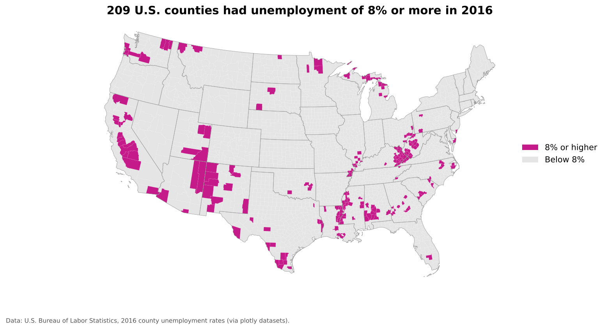
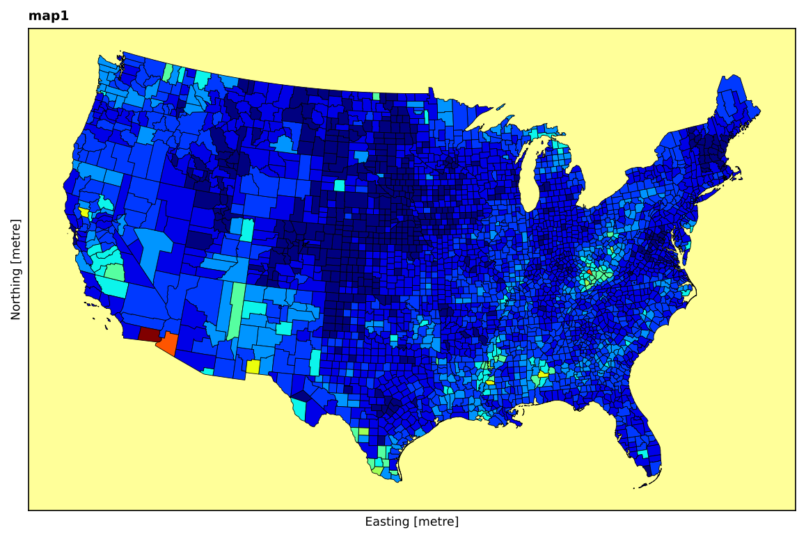
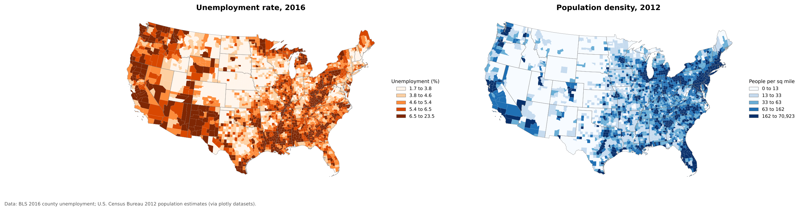

:::::::::::::::::::::::::::::::::::::: questions

- What should I decide before I start making a map?
- How do audience, message and medium shape a map's design?
- How can a map mislead, even when the data are correct?
- When do I need more data, or a better understanding of my data, before mapping?

::::::::::::::::::::::::::::::::::::::::::::::::

::::::::::::::::::::::::::::::::::::: objectives

- Identify the audience, purpose and medium of a map before designing it
- Choose the data attributes that support a single clear message
- Recognize design choices that confuse or mislead readers
- Decide whether additional data or research is needed
- Use a checklist to review a map before sharing it

::::::::::::::::::::::::::::::::::::::::::::::::

## Why plan before you map?

Maps are persuasive. People tend to trust them, and a map can be read in seconds. That makes a well
designed map a powerful way to share research, and a poorly designed one a powerful way to mislead.

Most map problems are decided before any software is opened: who the map is for, what it should say,
and which data can support that message. This episode is a set of questions to ask, in order, every
time you make a map. The next episode covers the design tools (color, classification, projections)
you use to answer them.

Good cartography rests on a few core design principles:

- **Legibility:** everything the reader needs can be read easily.
- **Visual contrast:** important features stand out from less important ones.
- **Figure and ground:** the data (figure) separates clearly from the background (ground), such as a
  basemap.
- **Hierarchy:** the most important element is noticed first, the least important last.
- **Balance:** the elements are arranged without clutter or large empty areas.

---

## 1. Know your audience

The audience shapes every other decision.

**Ask yourself:**

- Are they researchers, policymakers, community members or students?
- How familiar are they with maps and with your topic?
- How much detail can they use?

| Audience | Design implications |
|---|---|
| General public | Few classes, plain language labels, a title that states the conclusion, minimal jargon |
| Policymakers | One clear message, the places they are responsible for clearly marked, sources stated |
| Researchers | More detail, precise class breaks, projection and methods stated, uncertainty shown |

::::::::::::::::::::::::::::::::::::: callout

### Key idea

A map of the same data for scientists and for the public should not look the same.

::::::::::::::::::::::::::::::::::::::::::::::::

---

## 2. Define your message

Every map should answer one clear question. If you cannot state the message in one sentence, the
reader will not be able to find it either.

**Ask yourself:**

- What is the single most important takeaway?
- Am I showing a pattern, a comparison, or a change over time?

**Avoid:**

- Showing many variables at once on one map
- Leaving the reader to work out the point alone

A useful habit is to write the message as the map's title. The map below states its conclusion in the
title, shows only one distinction (8% or more versus below 8%), and greys out everything else so the
highlighted counties stand out.

{alt="Map of the contiguous United States with counties in light grey, except 208 counties shown in magenta where unemployment was 8% or higher in 2016. The title reads: 208 U.S. counties had unemployment of 8% or more in 2016. Highlighted counties cluster in central California, the Southwest and Navajo Nation area, Appalachian Kentucky, the Mississippi Delta and Alabama's Black Belt."}

---

## 3. Choose the right data attributes

Not all data belongs on your map. Select the variables that support your message and that make sense
spatially.

**Ask yourself:**

- Which variable answers my question?
- Do I need a supporting variable, such as population, to interpret it?
- What type of geometry do I have: points, lines or polygons?
- Is my variable a **count** (number of people) or a **rate** (percent, per 1,000, per square mile)?
  Counts on area maps usually need to be converted to rates; see the next episode.

**Matching data to visual variables:**

| Data | Visual variable | Example |
|---|---|---|
| Ordered quantities (low to high) | Lightness of one color | Unemployment rate |
| Magnitudes at locations | Symbol size | City population |
| Categories with no order | Different hues or shapes | Land use type |

:::::::::::::::::::::::::::::::::::: challenge

## Challenge 1: Which variable?

You have county data on average temperature, total precipitation and elevation. Your goal is a map of
**drought risk**. Which variable would you prioritize, and what else might you need?

:::::::::::::::::::::::: solution

**Precipitation** is the most direct indicator, because drought is a shortage of water. Even better is
precipitation compared with normal (for example, percent of the long-term average), since 20 inches a
year is normal in some places and a severe drought in others. Temperature is a useful supporting
variable because heat increases evaporation. Elevation alone says little about drought.

:::::::::::::::::::::::::::::::::
::::::::::::::::::::::::::::::::::::::::::::::::

---

## 4. Consider how readers will perceive the map

Maps are not neutral. Design choices change what readers believe.

**Ask yourself:**

- Do my colors carry meanings I do not intend (for example, red for "danger")?
- Does my classification make some places look worse or better than they are?
- Can the main pattern be seen at a glance?
- Can someone with color vision deficiency read it? (See the Accessibility episode.)

Darker or more saturated colors are read as "more". Keep that order consistent with the data: dark for
high values, light for low values.

The map below uses the same unemployment data as the map in section 2, and is very hard to read:

{alt="A deliberately poorly designed map of 2016 county unemployment. Counties are colored with a rainbow palette in 12 classes, mostly dark blue with scattered cyan, yellow and red counties. There is no legend and no meaningful title (only 'map1'), thick black county borders, a bright yellow background, and leftover axis labels reading Easting and Northing in metres."}

**What goes wrong here:**

- A rainbow palette has no natural order, so readers cannot tell which colors mean high or low.
- Twelve classes are more than anyone can match to a legend, and there is no legend anyway.
- The title ("map1") says nothing; the axis labels are leftover software defaults.
- Heavy black borders and a bright background compete with the data (poor figure and ground).
- Equal interval classes put almost every county in the first few classes, so most of the map is one
  dark blue.

**Best practice:** make the data the figure and everything else the ground. Use a light, muted basemap
or none at all, thin light boundaries, and a sequential palette with five to seven classes.

---

## 5. Choose the right medium

Where the map will be seen affects its design.

| Medium | Design implications |
|---|---|
| Web map | Interactive, zoomable; simplify the basemap; add halos to labels so they read over any background |
| Print | Static, high resolution; check how it looks in black and white; print a test copy |
| Slides | Simple and bold; large text; one message per slide; viewed from a distance |
| Social media | Small screens; very few classes; title and source inside the image |

**Ask yourself:** Will readers zoom in? Will it be printed in greyscale? How large will it appear?

---

## 6. Will your map inform decisions?

Some maps are exploratory; others guide real actions such as where to open a clinic or which
neighborhoods receive funding.

Decision making maps should:

- Be as accurate as the data allow
- Show uncertainty where possible (for example, margins of error for American Community Survey
  estimates, or hatching for unreliable values)
- Avoid simplifications that change the conclusion

Examples include flood risk maps used by planners and disease maps used during outbreaks.

::::::::::::::::::::::::::::::::::::: callout

### Important

If your map influences decisions, accuracy and clarity matter more than visual appeal.

::::::::::::::::::::::::::::::::::::::::::::::::

---

## 7. Understand what your audience already knows

**Ask yourself:**

- Do readers understand the variable (for example, what "median household income" means)?
- Do units, time periods or scales need explaining?
- Would an annotation help ("highest rate in the state")?

**Tips:**

- Include a legend with units and a descriptive title.
- Use plain language where possible.
- Give context: time period, geography and data source.
- Include the essential map elements: a **scale bar** when distance matters, a **north arrow** when
  orientation is not obvious, and a **source** line.

Aim for maximum information with minimum effort: the reader should get the main idea quickly, without
struggling.

---

## 8. Do you need more data?

Incomplete data can lead to misleading maps.

**Ask yourself:**

- Are there variables that change how this one should be read?
- Is the data recent enough?
- Is the spatial resolution right for the question (state, county, tract)?

For example, a map of unemployment rates can look dramatic in sparsely populated counties where a
change of a few hundred jobs moves the rate a lot. Showing population next to it puts the pattern in
context:

{alt="Two county maps of the contiguous United States side by side. Left: 2016 unemployment rate in five orange classes, with the darkest counties in the Pacific Northwest, California, the Southwest, Appalachia and the Deep South. Right: 2012 population density in five blue classes, dark in the East, the Great Lakes, California and Florida, and very light across most of the Great Plains and Mountain West."}

The darkest fifth of counties on the left (unemployment of 6.5% or more) are, on average, less densely
populated than other counties and together are home to only about 1 in 10 people in the contiguous
United States. Meanwhile, the 41 counties with more than a million residents had a median rate of 4.5%,
slightly below the median for all counties (5.0%). Neither map alone tells the whole story. Rates and counts answer different questions: "where is unemployment
common?" versus "where do most unemployed people live?"

---

## 9. Do you understand your data?

Before mapping, make sure you understand your dataset.

**Ask yourself:**

- What exactly does each variable measure, and how was it collected?
- Are there known biases, gaps or margins of error?
- Have you explored the data with summary statistics and quick plots?

**If not:**

- Do some exploratory analysis (histograms, maps of each variable)
- Read the metadata and documentation
- Ask someone who knows the data
- For advanced work, run a sensitivity check: does the pattern change if you change the
  classification, the year or the geographic unit?

---

## Cartography checklist

Before sharing a map, check that:

- [ ] I know my target audience
- [ ] The map has one clear message, stated in the title
- [ ] I chose the most relevant variable, and normalized counts where needed
- [ ] The design does not invite misleading interpretations
- [ ] The design fits the medium (web, print, slides)
- [ ] Accuracy and uncertainty are appropriate for any decisions it will inform
- [ ] Units, time period and source are stated
- [ ] I have the supporting data needed to interpret the pattern
- [ ] I understand how the data were collected and their limitations
- [ ] Colors are readable for people with color vision deficiency

:::::::::::::::::::::::::::::::::::: challenge

## Challenge 2: Review a map

Apply the checklist to the poorly designed map in section 4. Which items fail?

:::::::::::::::::::::::: solution

- **Clear message:** fails. The title is "map1" and nothing says what is shown.
- **Misleading interpretations:** fails. The rainbow palette and equal interval classes hide the
  pattern and make a few counties look extreme.
- **Units, time period, source:** fail. There is no legend, year or source.
- **Color vision deficiency:** fails. Rainbow palettes contain red and green pairs that many readers
  cannot distinguish.
- **Medium:** questionable. The bright background would print poorly and distract on screen.

:::::::::::::::::::::::::::::::::
::::::::::::::::::::::::::::::::::::::::::::::::

## Final thought

A good map is not only attractive. It is honest, clear and purposeful: it respects the data, serves its
audience, and communicates without distortion.

::::::::::::::::::::::::::::::::::::: discussion

- Think of a map you saw recently. What did it do well? What could be improved?
- How would you present the same data differently for a different audience?
- Share an example of a map that misled you, or one that worked brilliantly, and explain why.

::::::::::::::::::::::::::::::::::::::::::::::::

::::::::::::::::::::::::::::::::::::: keypoints

- Decide the audience, message and medium before designing a map.
- State the message in the title and show only the data that supports it.
- Rates and counts answer different questions; choose deliberately.
- Design choices such as palette and classification change what readers believe.
- Review every map against a checklist before sharing it.

::::::::::::::::::::::::::::::::::::::::::::::::
