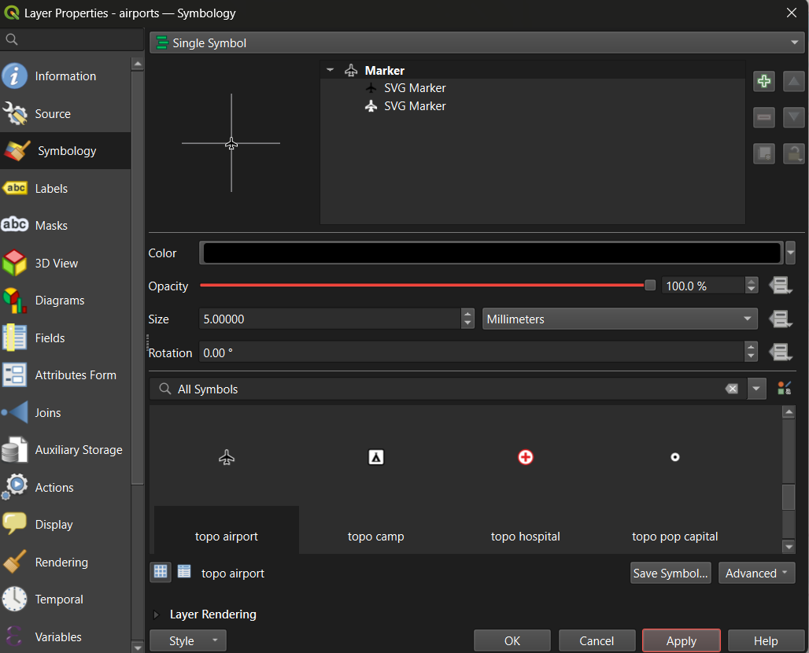
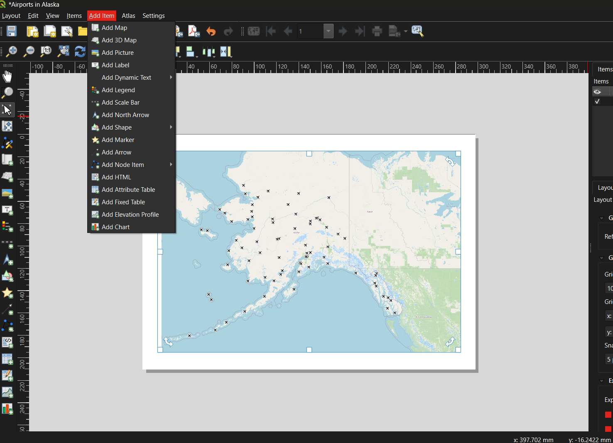
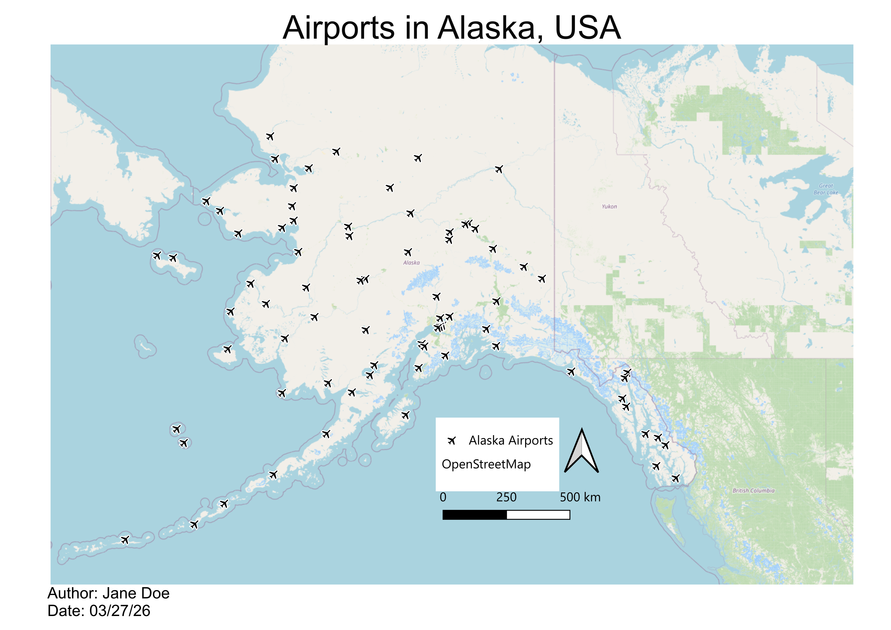

:::::::::::::::::::::::::::::::::::::: questions

- How do I load spatial data into QGIS, including directly from the web?
- How do I explore a layer's attributes?
- How can I style point data by category and polygon data by value?
- How do I create and export a finished map layout?

::::::::::::::::::::::::::::::::::::::::::::::::

::::::::::::::::::::::::::::::::::::: objectives

- Add a basemap and load a vector layer from a web address
- Explore a layer's attribute table
- Style points with categorized symbology
- Build a choropleth map with graduated symbology and compare classification methods
- Create a print layout with title, legend, scale bar, north arrow and source, and export it

::::::::::::::::::::::::::::::::::::::::::::::::

## Before you start

You need QGIS installed. If you have not installed it yet, or the interface is new to you, follow the
[Setup page](../learners/setup.md) first. These steps were written for the QGIS 3.x Long Term Release;
menus may differ slightly in other versions.

We will use two small datasets hosted with this lesson. **You do not need to download anything:** QGIS
can read a file directly from its web address.

| Dataset | Web address | Contents |
|---|---|---|
| Alaska airports (points) | `https://raw.githubusercontent.com/SpatialTurn/DataVisualization/main/data/alaska_airports.geojson` | 76 airports with `name`, `use` (civilian, military and so on) and `elevation`. From the QGIS sample dataset. |
| Indiana counties (polygons) | `https://raw.githubusercontent.com/SpatialTurn/DataVisualization/main/data/indiana_counties.geojson` | 92 counties with `pop_2012`, `land_sq_mi`, `density` (people per square mile) and `unemp_2016` (percent) |

---

## Part 1: Add a basemap

A basemap gives your data geographic context.

1. In the **Browser** panel (usually on the left), expand **XYZ Tiles**.
2. Right-click **OpenStreetMap** and choose **Add Layer to Project**.
3. A world map appears in the map canvas.

If you do not see the Browser panel, open it with **View > Panels > Browser**.

---

## Part 2: Load a layer from the web

1. Go to **Layer > Add Layer > Add Vector Layer**.
2. Under **Source Type**, choose **Protocol: HTTP(S), cloud, etc.**
3. Leave **Type** as **HTTP/HTTPS/FTP**.
4. In **URI**, paste the airports web address from the table above.
5. Click **Add**, then **Close**.

The 76 airports appear as points over Alaska, and a layer called `alaska_airports` appears in the
**Layers** panel.

6. If the points are hidden under the basemap, drag `alaska_airports` above `OpenStreetMap` in the
   Layers panel. Layers at the top of the list are drawn on top.
7. Right-click the airports layer and choose **Zoom to Layer**.

::::::::::::::::::::::::::::::::::::: callout

### Loading local files

To load a file saved on your computer instead, keep **Source Type** as **File** and browse to it. For a
shapefile, select the `.shp` file; the `.dbf`, `.shx`, `.prj` and `.cpg` files with the same name must
be in the same folder.

::::::::::::::::::::::::::::::::::::::::::::::::

Save your project now (**Project > Save**, which creates a `.qgz` file) and save regularly as you work.

---

## Part 3: Explore the attributes

1. Right-click the airports layer and choose **Open Attribute Table**.
2. You should see **76 rows**, one per airport, with the columns `name`, `use` and `elevation`.
3. Click the `use` column header to sort it. How many airports are military?

The attribute table holds the data behind the map. Every styling choice you make next is based on one
of these columns.

You can also click a single airport with the **Identify Features** tool (the "i" icon on the toolbar)
to see its attributes.

---

## Part 4: Style the points

First, give the airports a clearer symbol than the default dot.

1. Right-click the airports layer and choose **Properties**, then the **Symbology** tab.
2. With **Single Symbol** selected at the top, scroll the symbol library at the bottom and choose a
   marker such as **topo airport**. Set the **Size** to about 5 millimeters.
3. Click **Apply**.

{alt="Screenshot of the QGIS Layer Properties dialog for the airports layer on the Symbology tab. Single Symbol is selected at the top, the marker is an airplane SVG symbol called topo airport, color is black, opacity 100 percent and size 5 millimeters. The symbol library below shows topo airport, topo camp, topo hospital and topo pop capital."}

Now color the airports by how they are used:

4. Change **Single Symbol** to **Categorized**.
5. Set **Value** to `use`.
6. Click **Classify**. Each airport type gets its own color.
7. Double-click a symbol to change its color or size. Use clearly different colors (or shapes) for the
   four types.
8. Click **OK**.

Each renderer is suited to a type of data:

| Renderer | Use for | Example |
|---|---|---|
| **Single Symbol** | Showing where things are | All airports in one style |
| **Categorized** | Categories (no order) | Airport `use` |
| **Graduated** | Numbers (low to high) | County `density` |

To rename the layer, as it will appear in the legend, open **Properties > Source** and change the
**Layer name** (for example, to "Airports by use").

---

## Part 5: Build a choropleth map

Now load the Indiana counties and shade them by population density.

1. Load the Indiana counties web address the same way as in Part 2.
2. Open **Properties > Symbology** and change **Single Symbol** to **Graduated**.
3. Set **Value** to `density`.
4. Choose a **Color ramp** such as **Blues** or **Viridis**.
5. Set **Mode** to **Natural Breaks (Jenks)** and **Classes** to 5.
6. Click **Classify**, then **Apply** (not OK yet).
7. Change **Mode** to **Equal Interval**, click **Classify** and **Apply**. Then try **Equal Count
   (Quantile)**. Watch how the map changes.

Population density in Indiana is very skewed: most counties have fewer than 200 people per square mile,
and Marion County (Indianapolis) has over 2,000. With Equal Interval, almost every county lands in the
lightest class. Choose the mode that best shows your message, and click **OK**.

::::::::::::::::::::::::::::::::::::: callout

### Why density and not population?

The layer also has `pop_2012`, a count. Shading areas by a count mostly shows where big counties or
big cities are. Density (people per square mile) is a rate, so it can be compared fairly between
counties of different sizes. See the Normalization section of the Map Design episode.

::::::::::::::::::::::::::::::::::::::::::::::::

---

## Part 6: Create a map layout

To export a finished map with all its elements, use a **Print Layout**.

1. Go to **Project > New Print Layout** and give it a name.
2. **Add the map:** choose **Add Item > Add Map**, then click and drag a rectangle on the page.
3. **Add a title:** choose **Add Item > Add Label**, drag a box above the map, and type your title in the
   **Item Properties** panel. Make it large.
4. **Add a legend:** choose **Add Item > Add Legend** and drag a box. In Item Properties, you can rename
   entries and remove the basemap from the legend.
5. **Add a scale bar:** choose **Add Item > Add Scale Bar**. Set the units to miles or kilometers.
6. **Add a north arrow:** choose **Add Item > Add North Arrow**.
7. **Add a source line:** add another label at the bottom with the data source and your name, for
   example "Data: U.S. Census Bureau, BLS. Map by A. Student, 2026."

{alt="Screenshot of the QGIS Print Layout window titled Airports in Alaska. The Add Item menu is open, listing Add Map, Add 3D Map, Add Picture, Add Label, Add Dynamic Text, Add Legend, Add Scale Bar, Add North Arrow, Add Shape and other items. The page shows a map frame containing Alaska with airport symbols over an OpenStreetMap basemap."}

Use **Item Properties** to change fonts, sizes and frames. Use the **Move Item Content** tool to pan
the map inside its frame without moving the frame.

---

## Part 7: Export

1. In the layout window, choose **Layout > Export as Image** (PNG) or **Layout > Export as PDF**.
2. Choose a file name and location and accept the default options.
3. Save the project again (`.qgz`). The layout is saved inside the project.

{alt="A finished QGIS map titled Airports in Alaska, USA. Black airplane symbols mark 76 airports across Alaska over an OpenStreetMap basemap that also shows western Canada. A legend lists Alaska Airports and OpenStreetMap, with a north arrow and a scale bar from 0 to 500 kilometers. Author and date appear below the map."}

This example uses a single airport symbol. Your version will also show the airport types from Part 4.
Notice that it is missing one element from our list: a **data source** line.

---

## Common beginner mistakes

- Forgetting to save the project
- Mapping counts instead of rates on a choropleth map
- Leaving layer names such as `indiana_counties` in the legend
- Using too many classes or a rainbow color ramp
- Leaving out the source line, legend or title

::::::::::::::::::::::::::::::::::::: callout

### Keep it simple

Start with a clear, simple map. Add complexity only when it helps the reader.

::::::::::::::::::::::::::::::::::::::::::::::::

---

## Hands-on exercise

:::::::::::::::::::::::::::::::::::: challenge

## Challenge 1: An unemployment map of Indiana

Using the Indiana counties layer, create and export a finished map of **2016 unemployment rates**
(`unemp_2016`).

1. Use **Graduated** symbology with 5 classes and a sequential color ramp.
2. Try two classification modes and pick the one that shows the pattern best.
3. Build a layout with a title that states what the map shows, a legend with units (%), a scale bar,
   a north arrow and a source line.
4. Export it as a PNG.

:::::::::::::::::::::::::::::::::: solution

- **Value:** `unemp_2016`. **Color ramp:** a single hue such as Oranges or Blues (light for low, dark
  for high).
- **Mode:** unemployment ranges only from about 3.1% to 6.6% and is not very skewed, so **Natural
  Breaks** or **Equal Interval** both give readable maps. Quantile also works if the message is about
  rankings.
- **Legend:** rename the layer to something like "Unemployment rate, 2016 (%)".
- **Title:** for example, "Unemployment was highest in northwestern and southern Indiana in 2016". Check
  your own map before writing a conclusion like this.
- **Source:** "Data: U.S. Bureau of Labor Statistics, 2016."

::::::::::::::::::::::::::::::::::::
::::::::::::::::::::::::::::::::::::::::::::::::

:::::::::::::::::::::::::::::::::::: challenge

## Challenge 2: Fix the projection (optional)

Alaska looks stretched over the OpenStreetMap basemap, which uses Web Mercator. Change the project's
coordinate reference system to one designed for Alaska and compare.

:::::::::::::::::::::::::::::::::: solution

Click the **EPSG code** in the bottom-right corner of the QGIS window (or **Project > Properties > CRS**),
search for **3338** (NAD83 / Alaska Albers), select it and click **OK**. The map is redrawn in an equal
area projection for Alaska, and the state no longer looks enormously stretched. The basemap is
reprojected too, although its labels may look slightly blurred.

::::::::::::::::::::::::::::::::::::
::::::::::::::::::::::::::::::::::::::::::::::::

---

## Final takeaways

- QGIS is a free, powerful tool for designing maps.
- Layers can be loaded from files on your computer or directly from a web address.
- Categorized symbology suits categories; graduated symbology suits numbers.
- The print layout is where map elements (title, legend, scale bar, north arrow, source) come together.

::::::::::::::::::::::::::::::::::::: discussion

- What challenges did you face while making your first map?
- How would you change your map for a different audience?

::::::::::::::::::::::::::::::::::::::::::::::::

::::::::::::::::::::::::::::::::::::: keypoints

- Add Vector Layer with the HTTP(S) protocol loads data straight from a web address.
- The attribute table holds the data behind every styling choice.
- Use Categorized for categories and Graduated for numbers, and compare classification modes.
- A Print Layout combines the map with its title, legend, scale bar, north arrow and source.
- Save the project often; export layouts as PNG or PDF.

::::::::::::::::::::::::::::::::::::::::::::::::
